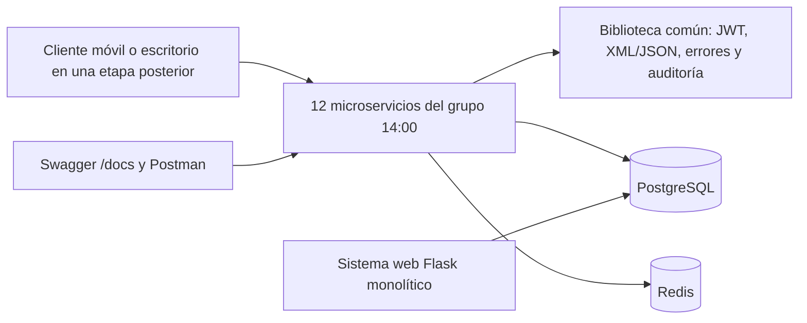

# EPIDEMIA — Reporte técnico de correcciones del segundo parcial

**Proyecto:** Sistema de respuesta a epidemias locales (Nuevo León)

**Corte de información:** 13 de octubre de 2026, después de la corrección XML

**Repositorio:** https://github.com/jonaxCA/A-D-M-Simulator

**Rama de entrega del grupo 14:00:** `feat/segundo-parcial-grupo-2pm`

**Commit verificado:** `215b4a5513b427dbf2d28a90b42318e7e3ba5030`

**Estado:** reporte de avance **parcial**. Separa funciones comprobadas de funcionalidades aún no integradas. No sustituye una demostración de la solución completa.

## 1. Problema y propósito

EPIDEMIA permite administrar información de enfermedades y regiones, registrar casos y evaluar escenarios de intervención mediante simulaciones epidemiológicas. El segundo parcial busca preparar una arquitectura distribuida con servicios pequeños, cada uno responsable de una operación específica, reutilizando la lógica existente del sistema web monolítico. El monolito conserva su conexión directa con PostgreSQL según el acuerdo documentado del equipo; las aplicaciones móvil y de escritorio se consideran trabajo posterior. Esta última distribución difiere de algunas exigencias generales de Blackboard y requiere constancia de la autorización del profesor si se presenta como excepción.

## 2. Alcance realmente integrado

La rama de las 14:00 contiene **12 microservicios Flask** con estructura de aplicación, rutas, `Dockerfile`, `README.md`, pruebas y contrato OpenAPI. El catálogo de arquitectura contempla **26** en total; los otros **14** están asignados al grupo de las 10:00 y no se consideran implementados por este reporte.

| Dominio | Microservicio | Puerto publicado | Responsabilidad |
|---|---|---:|---|
| Identidad | `auth` | 5201 | Inicio de sesión y emisión de tokens |
| Identidad | `sesiones` | 5202 | Renovación, cierre y revocación |
| Identidad | `usuarios` | 5203 | Administración de usuarios |
| Identidad | `roles` | 5204 | Roles, permisos y asignaciones |
| Catálogos | `enfermedades` | 5211 | Alta, consulta, edición y baja lógica |
| Catálogos | `parametros` | 5212 | Parámetros epidemiológicos con fuente o supuesto |
| Catálogos | `regiones` | 5213 | Consulta de Nuevo León y sus 51 municipios |
| Catálogos | `poblacion` | 5214 | Consulta y correcciones de población y grupos de edad |
| Catálogos | `tipos-intervencion` | 5215 | Catálogo de tipos de intervención |
| Analítica | `indicadores` | 5251 | Indicadores del tablero |
| Analítica | `series` | 5252 | Series epidemiológicas |
| Analítica | `zonas` | 5253 | Información territorial y mapa |

El módulo compartido `microservicios/comun/epidemia_comun/` aporta configuración, selección de XML/JSON, tratamiento de errores, creación uniforme de apps Flask, autenticación JWT y verificación de sesiones Redis, comunicación HTTP interna, utilidades de caché, cola y validaciones. Su uso evita replicar la misma lógica en cada microservicio.

## 3. Arquitectura e integración



- **HTTP:** rutas versionadas `/api/v1/...`; `GET`, `POST`, `PUT` y otros métodos donde aplica.
- **Formatos:** XML por omisión, JSON con `?format=json` o `Accept: application/json`; cuerpos XML/JSON mediante `Content-Type`.
- **Seguridad:** JWT, roles, revocación y sesión compartida en Redis para rutas protegidas; errores normalizados. Las pruebas unitarias no reemplazan la integración completa con el login y los clientes reales.
- **Base de datos:** PostgreSQL para datos estructurados, con roles separados y privilegios mínimos según la migración `026_roles_por_servicio.sql`.
- **Despliegue:** existe un Dockerfile individual por microservicio. `infra/docker-compose.yml` en esta rama **levanta Redis**, pero aún no constituye un despliegue conjunto de 26 servicios.
- **Swagger:** cada servicio ofrece `/docs` y `/openapi.json` con contrato en `docs/contratos/<servicio>/openapi.json`.

## 4. Corrección aplicada tras la evaluación: XML con grupos de edad

**Problema detectado.** La función `epidemia_comun.formatos.a_xml()` utilizaba claves de diccionario como nombres de etiquetas XML. Claves como `0-19` o `80+` son válidas en los datos, pero no como nombres de etiqueta XML. Esto afectaba respuestas de `enfermedades`, `parametros` y `poblacion` con bandas de edad o letalidad por edad.

**Solución integrada.** El serializador mantiene las etiquetas habituales cuando el nombre es válido. Cuando la clave no sirve como nombre XML, la convierte en un elemento `entrada` y guarda el nombre original en el atributo `clave`; el lector `de_xml()` recupera esa clave. Se mantienen los números, booleanos y valores nulos según las reglas del módulo.

```xml
<letalidad_por_edad>
  <entrada clave="0-19" tipo="numero">0.0001</entrada>
  <entrada clave="80+" tipo="numero">0.08</entrada>
</letalidad_por_edad>
```

La corrección y sus pruebas se integraron mediante **PR #115**, fusionado a `feat/segundo-parcial-grupo-2pm` en el commit `215b4a5`. Las tres pruebas que antes estaban marcadas `xfail` pasaron a ser pruebas normales que verifican el XML y la información recuperada.

**Referencias:** https://github.com/jonaxCA/A-D-M-Simulator/pull/115 ; `microservicios/comun/epidemia_comun/formatos.py` ; `microservicios/comun/tests/test_xml_claves_edad.py`.

## 5. Pruebas y evidencias verificables

| Evidencia | Resultado | Alcance y limitación |
|---|---|---|
| Suite de microservicios anterior a la corrección | **291 passed, 3 xfailed, 34 subtests passed** | Registro histórico, no estado actual |
| Suite después de corregir XML (ejecutada en Mac) | **307 passed, 34 subtests passed en 1.64 s** | Pruebas automatizadas; no certifica un despliegue de los 26 |
| Pruebas independientes de regresión de la revisión posterior al merge | **23/23 aprobadas** | Selección de pruebas; no suite completa de nuevo |
| Roles de PostgreSQL por servicio | **21/21 operaciones de permisos registradas** | Según `evidencias/pruebas/roles_postgres.txt`, con transacciones reversibles |
| Validación HTTP inicial de cuatro catálogos | **22/22 respuestas esperadas** | Entorno aislado en Docker; anterior al PR #115, no reemplaza validación final |
| Capturas de los 12 servicios | **36 imágenes** (`health.png`, `json.png`, `xml.png`) | Evidencia visual existente, no prueba de todos los métodos |

Evidencias trazables dentro del repositorio:

- `evidencias/pruebas/pytest_microservicios.txt` (291 / 3 `xfail`).
- `evidencias/pruebas/pytest_microservicios_xml_corregido.txt` (307 / 0 `xfail`).
- `evidencias/pruebas/roles_postgres.txt` (pruebas de permisos de base).
- `evidencias/servicios/<servicio>/health.png`, `json.png`, `xml.png` (12 servicios).
- `evidencias/README.md` (índice y guía para capturar pruebas).

**Interpretación de resultados.** Que una prueba responda HTTP 200 indica que ese caso específico funcionó, no que todas las operaciones y permisos de la API estén completos. Ninguna cifra de este reporte pretende acreditar la demostración integral de los 26 servicios.

## 6. División del trabajo y trazabilidad

La distribución vigente en la pestaña *Plan de trabajo y repartición* del Google Docs del equipo identifica:

| Grupo | Responsable | Servicios / componente |
|---|---|---|
| 14:00 | Luz Colunga | `auth`, `sesiones`, `usuarios`, `roles`; documentación general |
| 14:00 | Mauricio Gallardo Barbosa | `enfermedades`, `parametros`, `regiones`, `poblacion`; biblioteca común y plantilla |
| 14:00 | Carlos Rodrigo Gómez González (Charly) | `tipos-intervencion`, `indicadores`, `series`, `zonas`; seguridad entre componentes |
| 10:00 | Enrique Ortiz | Escenarios, intervenciones, validación, aprobación, XML de escenarios, casos y sincronización |
| 10:00 | Rolando Rivas | Corridas, simulador, resultados y notificaciones |
| 10:00 | Jonathan Correa | Comparación, Pareto, estado de servicios, apoyo a Docker y consola |
| 10:00 | Víctor Hugo Gutiérrez | Contratos/XSD y pruebas de integración, en coordinación con Rolando |

La autoría y la participación individual deben corroborarse con commits/PR y acuerdos del grupo. **No se infiere de una tabla quién ejecutó cada prueba ni se atribuye trabajo no verificado.**

PR principales revisados:

- [#111 — Biblioteca común y cuatro servicios de catálogos](https://github.com/jonaxCA/A-D-M-Simulator/pull/111).
- [#112 — Tipos de intervención, indicadores, series y zonas](https://github.com/jonaxCA/A-D-M-Simulator/pull/112).
- [#113 — Pruebas, roles por servicio, evidencias y manual técnico](https://github.com/jonaxCA/A-D-M-Simulator/pull/113).
- [#115 — Corrección XML y actualización de evidencias](https://github.com/jonaxCA/A-D-M-Simulator/pull/115).

## 7. Retroalimentación, ajustes y pendientes

**Atendido o documentado:**

- Revisión de responsabilidades de los 12 servicios mediante sus contratos OpenAPI; se verificaron 40 operaciones documentadas, sin duplicados exactos de método + ruta. Esto no prueba que no exista solapamiento de lógica interna.
- Corrección de XML para nombres de bandas de edad: fusionada y cubierta por pruebas.
- Manual e índice de evidencias actualizados tras la corrección; el índice conserva el historial para que no se pierda trazabilidad.
- Plan de trabajo y reparto por grupos registrado en Google Docs.

**Pendiente de comprobar o completar antes del cierre final:**

1. **Integración total:** confirmar el código y funcionamiento de los 14 servicios del grupo de las 10:00 y el flujo extremo a extremo, sin atribuirlo a la rama del grupo 14:00.
2. **Docker Compose general:** demostrar que los servicios, PostgreSQL, Redis y la consola levantan de acuerdo con el alcance final aprobado; el Compose actual de esta rama contiene Redis.
3. **Evidencia por operación:** peticiones y respuestas reales en JSON y XML (incluidos errores, autenticación, autorizaciones y escrituras con persistencia), no solo capturas genéricas de salud.
4. **Confirmar alcance con el profesor:** Blackboard menciona MongoDB, integración web con microservicios y un rango orientativo de 6–10 servicios; el acuerdo de equipo excluye MongoDB de esta etapa y propone 26 servicios. Registrar explícitamente cualquier excepción aprobada.
5. **Entrega final:** comprobar que documentación, repositorio y archivo de entrega tengan el mismo commit y no incluyan archivos `.env`, contraseñas ni tokens.

## 8. Guion de demostración breve

Sin modificar la presentación, la evidencia técnica se enseña así: abrir `docker compose ps` / `docker ps`; mostrar `/health` y `/docs` de un servicio; hacer una petición en XML y otra en JSON a un catálogo; intentar una solicitud inválida y documentar su HTTP 400/401/404; mostrar la consulta/persistencia real en PostgreSQL y las funciones de Redis disponibles; por último, si ya está integrado, recorrer el proceso completo del negocio. **No se declara demostrado ningún paso que no se haya ejecutado efectivamente.**

## 9. Criterio de cierre para el ZIP final

Crear el archivo final **solo después** de fusionar las correcciones y confirmar la rama de entrega. Tomar el contenido desde un commit exacto, conservar los contratos, manuales, evidencias permitidas, pruebas, instrucciones de instalación y referencia del historial Git. Excluir `.env`, secretos, entornos virtuales, cachés y temporales. Verificar que el ZIP pueda abrirse, que el commit quede anotado en su manifiesto y que el equipo lo identifique como versión entregable.

---

**Fuentes de esta versión:** código y documentación de la rama `feat/segundo-parcial-grupo-2pm` al commit `215b4a5`; PR #111, #112, #113 y #115; `docs/MANUAL_TECNICO.md`, `docs/arquitectura/arquitectura_v2.md`, `evidencias/README.md` y carpeta de evidencias; pestaña *Plan de trabajo y repartición* del documento compartido del equipo.
