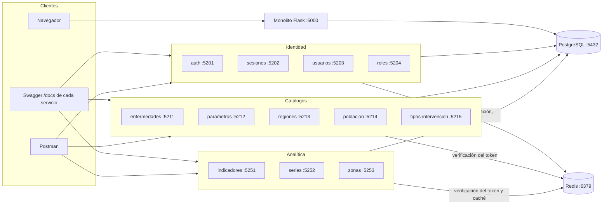

# EPIDEMIA — Arquitectura v2 (lo construido en el segundo parcial)

> **Estado: Vigente** · 2026-10-13 · Rama `feat/segundo-parcial-grupo-2pm`.
> Describe lo que **existe en el código hoy**. La propuesta completa de 26 servicios está en
> el catálogo ([`microservicios.md`](microservicios.md)), y el sistema final (ABM, MongoDB,
> Cloud Storage, nginx) en [`arquitectura_v1.md`](arquitectura_v1.md). Si algo de aquí choca
> con el código, gana el código.

## 1. Qué hay hoy

| Componente | Estado |
|---|---|
| Sistema web (monolito Flask, puerto 5000) | Funciona contra PostgreSQL, igual que en el primer parcial. No llama a los microservicios. |
| Microservicios del grupo de las 14:00 | **12 construidos**: identidad (4), catálogos (5) y analítica (3). |
| Microservicios del grupo de las 10:00 | Vigilancia, escenarios, simulación y plataforma: **no están en esta rama** (entrega del 22 de octubre). |
| Biblioteca común `epidemia_comun` | Construida: formatos, errores, JWT, Redis, `/health` y Swagger. |
| PostgreSQL | Una sola base, compartida por el monolito y los servicios. |
| Redis | En `infra/docker-compose.yml`, con contraseña y persistencia. |
| Docker | Un `Dockerfile` por servicio. El compose levanta **solo Redis**. |
| Consola de pruebas, `estado-servicios` | No construidos. Los servicios se prueban con Swagger (`/docs`) y la colección de Postman de `docs/contratos/postman/`. |
| MongoDB | No implementado. |

## 2. Vista general



- Los servicios **no se llaman entre sí por HTTP**: cada uno lee y escribe PostgreSQL con
  las funciones de `backend_web`, y comparte sesiones a través de Redis.
- Todos verifican el token del mismo modo (`@requiere_token` de la biblioteca común), con la
  misma `JWT_SECRET_KEY` y el mismo Redis.

## 3. Servicios construidos

Todas las rutas van bajo `/api/v1/`. Además, cada servicio tiene `/health`, `/docs` (Swagger
UI) y `/openapi.json`, servido desde `docs/contratos/<servicio>/openapi.json`.

### Identidad

| Servicio | Puerto | Rutas | Acceso | Escribe |
|---|---|---|---|---|
| `auth` | 5201 | `GET /auth/captcha`, `POST /auth/login` | Público | `users` (intentos fallidos y último acceso); Redis: sesión y captcha |
| `sesiones` | 5202 | `POST /sessions/refresh`; `POST /sessions/logout`, `GET /sessions/current`; `DELETE /sessions/user/{id}` | Público con *refresh*; cualquier sesión; solo token de servicio | Redis |
| `usuarios` | 5203 | `GET/POST /users`, `GET/PUT/DELETE /users/{id}`, `POST /users/{id}/activate` y `/deactivate` | `ADMINISTRADOR` | `users` |
| `roles` | 5204 | `GET /roles`, `GET /roles/{id}/permissions`, `PUT /roles/assignments/{user_id}` | `ADMINISTRADOR` | `user_roles` |

### Catálogos

| Servicio | Puerto | Rutas | Acceso | Escribe |
|---|---|---|---|---|
| `enfermedades` | 5211 | `GET/POST /diseases`, `GET/PUT /diseases/{id}`, `POST /diseases/{id}/activate` y `/deactivate` | Lectura pública; escritura `EPIDEMIOLOGO` o `ADMINISTRADOR` | `diseases` (sin `default_params`) |
| `parametros` | 5212 | `GET/PUT /diseases/{id}/parameters`, `GET /diseases/{id}/parameters/status` | Lectura pública; escritura `EPIDEMIOLOGO` o `ADMINISTRADOR` | `diseases.default_params` |
| `regiones` | 5213 | `GET /regions`, `GET /regions/{id}` | Público | — |
| `poblacion` | 5214 | `GET/PUT /regions/{id}/population`, `GET/PUT /regions/{id}/age-groups` | Lectura pública; escritura `ADMINISTRADOR` | `regions.population`, `region_age_groups` y sus correcciones |
| `tipos-intervencion` | 5215 | `GET /intervention-types`, `GET /intervention-types/{code}` | Público | — |

### Analítica

| Servicio | Puerto | Rutas | Acceso | Redis |
|---|---|---|---|---|
| `indicadores` | 5251 | `GET /dashboard/indicators`, `GET /dashboard/situation` | Público | Caché de 60 s |
| `series` | 5252 | `GET /series/cases`, `.../by-age`, `.../by-sex`, `.../totals` | Cualquier sesión | Caché de 60 s |
| `zonas` | 5253 | `GET /zones`, `GET /zones/map` | Cualquier sesión | Caché de 60 s |

El detalle de cada ruta (parámetros, cuerpos, respuestas y errores, con ejemplos en JSON y
XML) está en su `openapi.json` y en el `README.md` de cada carpeta de `microservicios/`.

## 4. Estructura de un servicio

Los 12 tienen la misma forma:

```
microservicios/<servicio>/
  __init__.py
  app.py        crear_app("<servicio>", contrato, registrar) y el puerto local
  rutas.py      registrar(app): las rutas del servicio
  Dockerfile    imagen propia, escucha en 8000, HEALTHCHECK a /health
  README.md     qué hace, rutas, roles, variables y cómo probarlo
  tests/        pruebas unitarias (los de catálogos se prueban en comun/tests)
docs/contratos/<servicio>/openapi.json
```

`crear_app()` (biblioteca común) arma la app Flask con:

- lectura de la configuración, que se niega a arrancar sin `JWT_SECRET_KEY` y `REDIS_URL`
  o con un secreto de ejemplo;
- manejo de errores en formato RFC 7807, sin exponer trazas ni SQL;
- `/health`, que revisa PostgreSQL (`SELECT 1`) y Redis (`PING`): 200 si los dos responden,
  503 (`degradado`) si no;
- `/docs` y `/openapi.json`;
- `X-Correlation-ID` en cada respuesta y registro de cada petición (método, ruta, código,
  duración y usuario);
- CORS solo para el origen de `CONSOLE_ORIGIN`, si se define.

## 5. Biblioteca común (`microservicios/comun/epidemia_comun`)

| Módulo | Para qué |
|---|---|
| `ajustes` | Carga y valida la configuración. |
| `fabrica` | `crear_app()`. |
| `formatos` | `responder()` (XML por defecto, JSON con `?format=json` o `Accept: application/json`) y `leer_cuerpo()` (JSON o XML según `Content-Type`, con `defusedxml` y límite de 1 MB). |
| `errores` | `ErrorAPI` y la respuesta `application/problem+json` o `application/problem+xml`. |
| `seguridad` | `@requiere_token(roles=...)` y `@solo_servicios`. |
| `sesiones` | Abrir, renovar, cerrar y revocar sesiones en Redis. |
| `cache` | Caché de consultas con TTL; si Redis falla, calcula con la base y sigue. |
| `candados`, `cola` | Candados y cola en Redis (los usarán `corridas` y `simulador`). |
| `llaves` | Nombres de las llaves de Redis. |
| `redis_compartido` | Cliente único de Redis, con tiempo de espera corto; `requerido()` lanza 503 si Redis está caído. |
| `validaciones`, `ambito` | Validación de enteros, cuerpos, parámetros epidemiológicos y filtros de ámbito. |
| `http` | `llamar()` para llamadas entre servicios (todavía ningún servicio lo usa). |

## 6. Formatos y errores

- **Respuesta:** XML por defecto; JSON con `?format=json` o `Accept: application/json`. Si
  chocan, manda `?format`. Un `?format` distinto de `json` o `xml` es 400.
- **Cuerpo:** JSON (`application/json`) o XML (`application/xml`). Otro `Content-Type` es 415.
- **XML:** los números llevan `tipo="numero"`, los booleanos `tipo="booleano"` y los nulos
  `nil="true"`. Los elementos de una lista usan el singular de la lista o `item`.
- **Errores:** RFC 7807 con un `codigo` estable:

| HTTP | `codigo` | Cuándo |
|---|---|---|
| 400 | `DATOS_INVALIDOS` | Formato desconocido o cuerpo ilegible |
| 401 | `TOKEN_AUSENTE`, `TOKEN_INVALIDO`, `TOKEN_EXPIRADO`, `TOKEN_REVOCADO` | Falta el token, no es válido, venció o su sesión se cerró |
| 401 | `CREDENCIALES_INVALIDAS` | Login fallido (solo `auth`) |
| 403 | `PERMISO_INSUFICIENTE` | El rol no alcanza |
| 404 | `NO_ENCONTRADO` | No existe el registro |
| 409 | `CONFLICTO` | Duplicado o regla de negocio |
| 415 | `DATOS_INVALIDOS` | `Content-Type` no soportado |
| 422 | `DATOS_INVALIDOS` | Validación |
| 503 | `SERVICIO_NO_DISPONIBLE` | Redis caído en una ruta que lo necesita |
| 500 | `ERROR_INTERNO` | Fallo no previsto (sin traza) |

## 7. Seguridad

### Inicio de sesión y uso del token

```mermaid
sequenceDiagram
    participant C as Cliente
    participant A as auth
    participant S as sesiones
    participant X as Otro servicio
    participant R as Redis
    participant P as PostgreSQL

    C->>A: GET /api/v1/auth/captcha
    A->>R: SET captcha:<id> (300 s)
    A-->>C: captcha_id, pregunta
    C->>A: POST /api/v1/auth/login (usuario, password, captcha)
    A->>R: GET y DEL captcha:<id>
    A->>P: Revisa la contraseña (bcrypt) y el bloqueo; bitácora LOGIN / LOGIN_FAILED
    A->>R: Abre session:<h(sid)>, refresh:<h(rt)>, user:<id>:sessions (8 h)
    A-->>C: access (20 min) y refresh
    C->>X: Petición con Authorization: Bearer <access>
    X->>R: ¿jwt:revoked:<jti>? ¿session:<h(sid)>?
    X-->>C: Respuesta, o 401 / 403
    C->>S: POST /api/v1/sessions/refresh (refresh)
    S->>R: Rota el refresh
    S-->>C: access y refresh nuevos
    C->>S: POST /api/v1/sessions/logout
    S->>R: SET jwt:revoked:<jti>; borra la sesión
```

- **Access:** JWT HS256 de 20 minutos con `iss` (`epidemia-auth`), `aud` (`epidemia-api`),
  `sub`, `roles`, `sid`, `jti`, `iat`, `nbf` y `exp`.
- **Sesión:** 8 horas desde el login; renovar no la alarga.
- **Refresh:** de un solo uso. Si se presenta uno ya usado, se cierra la sesión completa.
- **Verificación:** `@requiere_token` revisa la firma, el emisor, la audiencia, el
  vencimiento, que el `jti` no esté revocado, que la sesión siga abierta y el rol. Con Redis
  caído responde 503 y nunca deja pasar.
- **Captcha:** cada login pide uno nuevo (una suma de dos dígitos), de un solo uso, que se
  revisa antes de la contraseña.
- **Bloqueo:** cinco contraseñas equivocadas bloquean la cuenta 15 minutos (regla de
  `backend_web.auth`). Cuenta inexistente, inactiva, bloqueada o contraseña equivocada dan
  la misma respuesta.
- **Cierre forzado:** desactivar o eliminar una cuenta, cambiar su contraseña o cambiar su
  rol cierra todas sus sesiones, antes de confirmar el cambio en la base.
- **Roles:** `ANALISTA`, `EPIDEMIOLOGO` y `ADMINISTRADOR`, los del monolito. Cada cuenta
  tiene un rol.
- **Bitácora:** toda escritura en la base se registra en `audit_log` con `log_audit()`; nunca
  se guardan contraseñas ni `password_hash`.

## 8. Redis

| Llave | Contenido | TTL | La escribe |
|---|---|---|---|
| `session:<h(sid)>` | Hash: usuario, roles, creada, expira y huella del refresh vigente | 8 h desde el login | `auth`, `sesiones` |
| `user:<id>:sessions` | Huellas de las sesiones de una cuenta | 8 h | `auth`, `sesiones` |
| `refresh:<h(rt)>` | Huella del `sid` de su sesión | Lo que le quede a la sesión | `auth`, `sesiones` |
| `refresh:usado:<h(rt)>` | Huella del `sid` de un refresh ya rotado | Lo que le quede a la sesión | `sesiones` |
| `jwt:revoked:<jti>` | `1` | Lo que le quede al access, más 60 s | `sesiones` |
| `captcha:<id>` | Respuesta del captcha | 300 s; se borra al usarse | `auth` |
| `cache:<servicio>:<clave>` | Respuesta en JSON | 60 s | `indicadores`, `series`, `zonas` |

- Del `sid` y del refresh solo se guarda la huella SHA-256.
- Configuración del compose: contraseña obligatoria, `appendonly yes`, `maxmemory 256mb` y
  `noeviction` (con la memoria llena rechaza escrituras en vez de borrar sesiones). Se
  publica solo en `127.0.0.1:6380`.
- Con Redis caído: las rutas protegidas y las de `auth` y `sesiones` responden 503; las
  públicas siguen respondiendo, y la caché calcula con la base.

## 9. PostgreSQL

- Una sola base (`simulador_epidemico`), creada con el dump, las semillas y las migraciones
  de `datos/postgres/migraciones/` (ver [`INSTALACION.md`](../INSTALACION.md)). Hoy todos se conectan con el mismo DATABASE_URL.
- Los servicios usan las funciones de `backend_web` (`queries.py`, `auth.py`, `audit.py`);
  las escrituras propias de un servicio van en una transacción, con su `log_audit(..., cur=cur)`.
- Cada servicio escribe solo las tablas de la columna "Escribe" de la sección 3. Hoy todos
  se conectan con el mismo `DATABASE_URL`; los roles de PostgreSQL por servicio no están
  creados.

## 10. Despliegue

- **Imagen de cada servicio:** `python:3.12-slim`, usuario sin privilegios (`epidemia`), las
  dependencias de `backend_web`, `procesamiento` y `epidemia_comun`, y `waitress` en el
  puerto 8000. `HEALTHCHECK` cada 30 s contra `/health`: el contenedor queda sano solo si
  llega a PostgreSQL y a Redis.
- **Compose (`infra/docker-compose.yml`):** solo Redis, con su volumen `redis-datos`. Los
  servicios todavía no están en el compose.
- **Puertos:** cada servicio publica el de la sección 3; el monolito usa 5000 y PostgreSQL
  5432.
- Cómo levantarlo: [`INSTALACION.md`](../INSTALACION.md), sección "Microservicios".

## 11. Pruebas

- Unitarias con `pytest`, con PostgreSQL y Redis simulados (`fakeredis`); no necesitan
  Docker. Resultado del 13 de octubre: **200 pasan, 0 fallan**
  (`evidencias/pruebas/pruebas_unitarias_2026-10-13.txt`).
- Cubren: respuestas en XML y JSON, cuerpos en los dos formatos, validaciones, tokens
  ausentes, inválidos y revocados, roles sin permiso, Redis caído, bitácora y que el
  `openapi.json` servido sea el de `docs/contratos/`.
- Pruebas de integración contra contenedores: no hechas.

## 12. Pendientes y fuera de alcance

### Fuera de alcance de este parcial

- Las apps móvil y de escritorio: se entregan en el tercer parcial.
- MongoDB, Google Cloud Storage y nginx.
- Del grupo de las 10:00: los XSD, las pruebas de integración del flujo completo, el
  docker-compose con todos los servicios y la consola.

### Pendientes del grupo 14:00

- `epidemia_comun.formatos.a_xml` usa las claves del diccionario como etiqueta; claves como
  `0-19` u `80+` producen XML mal formado. Se confirmó con los servicios corriendo: falla el
  XML de `GET /api/v1/diseases`, el de `parametros` cuando la enfermedad tiene
  `letalidad_por_edad` (COVID-19 e influenza) y el de `GET /regions/{id}/age-groups`. En JSON
  responden bien. Hay tres pruebas `xfail` que lo documentan. La corrección va en la
  biblioteca común (por ejemplo, `<entrada clave="0-19">`, que es lo que muestra el ejemplo
  XML de `age-groups`), no en los servicios.

### Corregido en esta entrega

- `poblacion`: `PUT /age-groups` descartaba `expected_groups.edad_no_especificada`, que el
  control de concurrencia de `backend_web` compara, y toda corrección terminaba en error.
  Ahora la ruta la valida y la pasa, como la pantalla del monolito.
- `poblacion`: el mensaje de concurrencia "Los datos del municipio cambiaron mientras
  editabas" salía como 422; ahora, como los otros dos, es 409 `CONFLICTO`.
- Migración 026: fallaba en una base real al buscar la secuencia de `user_roles`, que no
  tiene columna `id`. Se corrigió y ya está al final de `dump_completo.sql`.

### Diferencias entre el plan y el código

- Ningún servicio emite todavía tokens de servicio; `usuarios` y `roles` cierran sesiones
  directo en Redis en vez de llamar a `DELETE /api/v1/sessions/user/{id}`.
- `@requiere_token` revisa Redis con el cliente de la fábrica, no con `sesiones.verificar()`.
- `auth` usa la ruta `GET /api/v1/auth/captcha` y la llave `captcha:<id>`, que no están en el
  catálogo ni en `llaves.py`.
- Los servicios leen `DATABASE_URL`; para usar su rol de la 026 hay que pasarles la URL con
  `svc_<servicio>`.
- Los servicios no están todavía en `infra/docker-compose.yml` (el compose completo es del
  grupo de las 10:00).
