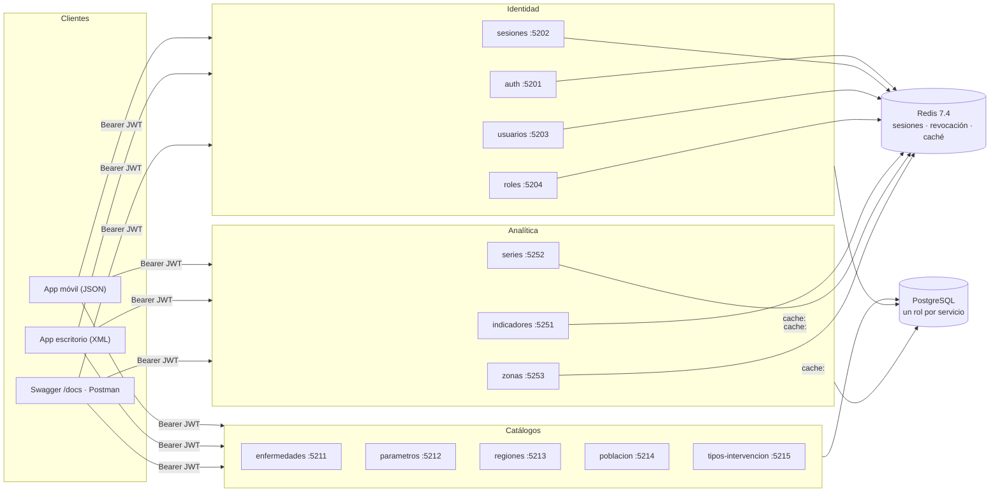

# EPIDEMIA — Arquitectura v2 

> **Estado: vigente** 2026-10-13 · Este documento es un acta de lo construido en  `microservicios/`,
> no el plan del sistema completo.
> El plan de 27 servicios está en [`microservicios.md`](microservicios.md); el
> sistema final (a actualizar), en [`arquitectura_v1.md`](arquitectura_v1.md). Si este documento y el
> código no coinciden, manda el código.

## Qué se construyó

- **12 microservicios Flask** del grupo de las 14:00: identidad (`auth`, `sesiones`,
  `usuarios`, `roles`), catálogos (`enfermedades`, `parametros`, `regiones`, `poblacion`,
  `tipos-intervencion`) y analítica (`indicadores`, `series`, `zonas`).
- **Biblioteca común** `epidemia_comun` (`microservicios/comun/`): fábrica de apps, formatos
  XML/JSON, errores RFC 7807, verificación de JWT y la capa de Redis.
- **Redis 7.4** en `infra/docker-compose.yml` (por ahora es lo único que levanta el compose).
- **Un rol de PostgreSQL por servicio** en la migración `026_roles_por_servicio.sql`.
- Un `Dockerfile` por servicio, contrato OpenAPI en `docs/contratos/<servicio>/` y Swagger en
  `/docs` de cada uno. XSD del error, de la enfermedad y de sus parámetros, validados con
  `xmlschema` (D15).
- **Pruebas de integración iniciales** del flujo de identidad entre `auth`, `sesiones`,
  `usuarios` y `roles` (`microservicios/pruebas_integracion/`).

Los servicios son para las apps de escritorio (XML) y móvil (JSON) del tercer parcial. El
monolito (`frontend_web`) sigue hablando directo con PostgreSQL y no los llama.

### Del grupo de las 10:00 (no descritos aquí)

`casos`, `sincronizacion`, `escenarios`, `intervenciones`, `aprobacion`, `validacion`,
`escenarios-xml`, `corridas`, `simulador`, `resultados`, `comparacion`, `pareto`,
`notificaciones`, `estado-servicios`, la consola, el `docker-compose` completo, los XSD de escenario, resultado de una corrida, caso y lote de sincronización
y las pruebas de integración del flujo completo. Están en el catálogo; este documento no los da por
hechos.

## Diagrama



Todas las rutas protegidas (de cualquier servicio) consultan Redis para saber si la sesión
sigue abierta y si el token fue revocado.

## Los 12 servicios

| Servicio | Puerto | Rutas | Acceso | Escribe | Lee | Redis |
|---|---|---|---|---|---|---|
| `auth` | 5201 | `GET /api/v1/auth/captcha`, `POST /api/v1/auth/login` | Públicas | `users` (intentos, último acceso) | `users`, `roles`, `user_roles` | `captcha:<id>` (300 s), abre `session:`, `refresh:`, `user:<id>:sessions` |
| `sesiones` | 5202 | `POST /api/v1/sessions/refresh`, `POST .../logout`, `GET .../current`, `DELETE .../user/{id}` | refresh público; logout y current con token; `user/{id}` solo token de servicio | — | — | `session:`, `refresh:`, `refresh:usado:`, `jwt:revoked:` |
| `usuarios` | 5203 | `GET/POST /api/v1/users`, `GET/PUT/DELETE /api/v1/users/{id}`, `POST .../{id}/activate` y `/deactivate` | ADMINISTRADOR | `users` | `roles`, `user_roles`, tablas con FK a `users` | cierra `user:<id>:sessions` |
| `roles` | 5204 | `GET /api/v1/roles`, `GET /api/v1/roles/{id}/permissions`, `PUT /api/v1/roles/assignments/{user_id}` | ADMINISTRADOR | `user_roles` | `users`, `roles`, `permissions`, `role_permissions` | cierra `user:<id>:sessions` |
| `enfermedades` | 5211 | `GET/POST /api/v1/diseases`, `GET/PUT /api/v1/diseases/{id}`, `POST .../activate` y `/deactivate` | GET público; escrituras EPIDEMIOLOGO o ADMINISTRADOR | `diseases` (no `default_params`) | `cases`, `regions` | — |
| `parametros` | 5212 | `GET/PUT /api/v1/diseases/{id}/parameters`, `GET .../parameters/status` | GET público; PUT EPIDEMIOLOGO o ADMINISTRADOR | `diseases.default_params` | `diseases` | — |
| `regiones` | 5213 | `GET /api/v1/regions`, `GET /api/v1/regions/{id}` | Público | — | `regions`, `region_age_groups`, `region_population_adjustments`, `audit_log` | No la usa |
| `poblacion` | 5214 | `GET/PUT /api/v1/regions/{id}/population`, `GET/PUT /api/v1/regions/{id}/age-groups` | GET público; PUT ADMINISTRADOR | `regions.population`, `region_age_groups`, `region_population_adjustments` | `regions` | — |
| `tipos-intervencion` | 5215 | `GET /api/v1/intervention-types`, `GET .../{code}` | Público | — | `intervention_types` | — |
| `indicadores` | 5251 | `GET /api/v1/dashboard/indicators`, `GET .../situation` | Público | — | `cases`, `regions`, `diseases`, `simulation_runs` | `cache:indicadores:*` (60 s) |
| `series` | 5252 | `GET /api/v1/series/cases`, `.../by-age`, `.../by-sex`, `.../totals` | Token, cualquier rol | — | `cases`, `regions`, `diseases` | `cache:series:*` (60 s) |
| `zonas` | 5253 | `GET /api/v1/zones`, `GET /api/v1/zones/map` | Token, cualquier rol | — | `cases`, `regions`, `diseases` | `cache:zonas:*` (60 s) |

Todos sirven además `/health`, `/docs` (Swagger UI) y `/openapi.json`. Toda escritura se
audita en `audit_log` dentro de la misma transacción.

## Autenticación con JWT

```mermaid
sequenceDiagram
    participant C as Cliente
    participant A as auth
    participant R as Redis
    participant S as sesiones
    participant X as Cualquier servicio

    C->>A: GET /auth/captcha
    A->>R: captcha:<id> (300 s)
    C->>A: POST /auth/login (usuario, password, captcha)
    A->>R: session:<h(sid)>, refresh:<h(rt)>, user:<id>:sessions (8 h)
    A-->>C: access (20 min) + refresh
    C->>X: GET ... Authorization: Bearer access
    X->>R: ¿existe jwt:revoked:<jti>? ¿existe session:<h(sid)>?
    X-->>C: 200, o 401 TOKEN_REVOCADO, o 503 si Redis no responde
    C->>S: POST /sessions/refresh (refresh)
    S->>R: rota el refresh; el usado queda en refresh:usado:
    S-->>C: access nuevo + refresh nuevo
    C->>S: POST /sessions/logout
    S->>R: jwt:revoked:<jti>, borra session:
```

- **Access:** HS256, 20 minutos. Claims `iss` (`epidemia-auth`), `aud` (`epidemia-api`),
  `sub`, `roles`, `sid`, `jti`, `iat`, `nbf` y `exp`. Se rechaza `alg: none`, otra firma,
  vencido, otra audiencia, revocado y rol insuficiente.
- **Sesión:** 8 horas desde el login; renovar no la alarga. En Redis solo hay huellas
  (SHA-256) del `sid` y del refresh.
- **Refresh de un solo uso:** reutilizar uno ya rotado cierra la sesión completa.
- **Token de servicio:** audiencia propia `epidemia-interno`, sin `sid`. Solo lo aceptan las
  rutas con `@solo_servicios` (hoy, `DELETE /api/v1/sessions/user/{id}`), y esas rutas
  rechazan el token de una persona.
- **Redis caído:** una ruta protegida responde 503 y nunca deja pasar. Las públicas siguen;
  la caché de analítica consulta directo la base.

## Formatos y errores

- XML por omisión; JSON con `?format=json` o `Accept: application/json` (si chocan, manda
  `?format`). Un `?format` desconocido es 400.
- Los cuerpos se aceptan en JSON o XML según el `Content-Type`; el XML se lee con
  `defusedxml`. Otro `Content-Type` es 415.
- Errores RFC 7807 (`application/problem+json` o `problem+xml`) con un `codigo`:
  `TOKEN_AUSENTE`, `TOKEN_INVALIDO`, `TOKEN_EXPIRADO`, `TOKEN_REVOCADO`,
  `PERMISO_INSUFICIENTE`, `CREDENCIALES_INVALIDAS`, `NO_ENCONTRADO`, `CONFLICTO`,
  `DATOS_INVALIDOS`, `SERVICIO_NO_DISPONIBLE` y `ERROR_INTERNO`. Un 500 no expone la traza.

## Decisiones aplicadas

| Decisión | En el código |
|---|---|
| D9 Formato | XML por defecto, JSON con `?format=json` o `Accept` |
| D10 Entregas | Servicios y contratos ahora; apps en el tercer parcial |
| D11 Rutas en inglés | Todo bajo `/api/v1/` |
| D12 Nombres en español | Carpetas y `/health` con el nombre del catálogo (`tipos_intervencion` es carpeta por Python; el servicio se llama `tipos-intervencion`) |
| D13 Sin pasarela | Cada servicio en su puerto; `estado-servicios` (grupo 10:00) será el directorio |
| D14 pytest | Todas las pruebas de `microservicios/` corren con `pytest` |
| D16 Migraciones desde la 026 | `026_roles_por_servicio.sql` |

## Diferencias con el plan

- `auth` expone `GET /api/v1/auth/captcha` y guarda `captcha:<id>` en Redis; ni la ruta ni la
  llave están en el catálogo ni en `llaves.py`.
- `@requiere_token` revisa `session:` y `jwt:revoked:` directo con el cliente de Redis de la
  fábrica, no con `sesiones.verificar()` como dice el catálogo.
- `usuarios` y `roles` cierran sesiones con `sesiones.cerrar_todas()` sobre Redis, no llamando
  a la ruta interna de `sesiones`. Ningún servicio emite todavía tokens de servicio.
- `enfermedades` inserta `default_params = '{}'` al dar de alta, así que su rol tiene INSERT en
  esa columna aunque el catálogo diga "todo menos `default_params`".
- Cada servicio lee `DATABASE_URL`; para usar su rol de la 026 hay que darle la URL con ese
  usuario.
