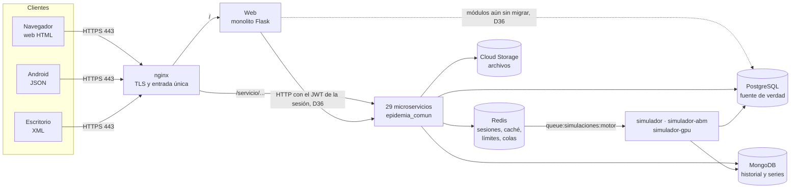
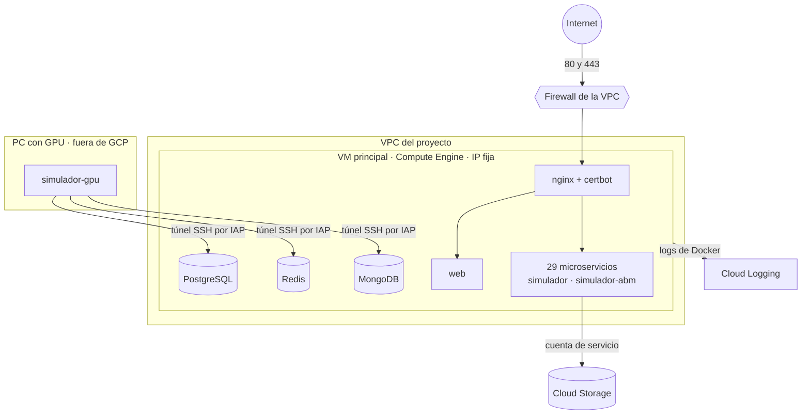

# Arquitectura v3

> **Estado: Borrador** · 2026-11-14 · Al día con las ramas integradas el 2026-11-19 · Por validar en equipo (paso 6 de §11 de [`brechas_v3.md`](brechas_v3.md)). Al validarse reemplaza a [`arquitectura_v2.md`](arquitectura_v2.md); mientras tanto, lo que este documento no cambia sigue como en la v2.

La v3 es la arquitectura del tercer parcial: las apps cliente, la entrada por nginx, MongoDB, Cloud Storage, los límites de consumo, el ABM y el despliegue en GCP. Sale de los tres procesos ([`procesos_v3.md`](procesos_v3.md)), de las decisiones D1 a D39 ([`decisiones.md`](../decisiones/decisiones.md)), de la retroalimentación del profesor ([checklist del tercer parcial](../parciales/parcial-3/checklist.md)) y del código de `feat/tercer-parcial` al 2026-11-19. Enlaza en vez de copiar: el detalle de cada servicio está en [`microservicios.md`](microservicios.md), y el del simulador en [`ficha_simulador.md`](ficha_simulador.md).

Si este documento y el catálogo no coinciden, manda el catálogo; si el catálogo y el código no coinciden, manda el código.

Cada pieza lleva su estado:

- **Hecho:** está en el código y tiene pruebas.
- **Falta:** está decidido y no implementado. Lleva su brecha y el bloque del checklist que la tiene: 0 coordinación y validación científica, A escritorio, B Android, C web, D datos, E microservicios y seguridad, F nube y monitoreo.
- **Propuesta:** una forma de hacerlo que el equipo todavía no decide.
- **Reabierto:** la retroalimentación lo pide y choca con una decisión vigente; la decisión nueva es del bloque 0.

## 1. Qué cambia respecto a la v2

| Tema | v2 | v3 | Decisión | Estado |
|---|---|---|---|---|
| Entrada | Sin pasarela: cada servicio publica su puerto y el directorio da `host:puerto` | nginx en 80 y 443 con TLS; los servicios dejan de publicar puertos y el directorio da `https://<dominio>/<servicio>` | D25, D26 (ajustan D13) | **Hecho en local** (2026-11-19): `infra/docker-compose.nginx.yml`, probado con `--nginx`. HTTPS gratuito listo para la máquina: Let's Encrypt con `<ip>.sslip.io` (`infra/nginx/letsencrypt.sh`); falta correrlo en la VM (N1, S6; bloque F) |
| Web | Crea escenarios y lanza corridas | Consulta y aprueba; el diseño y las corridas son del escritorio | D4 | **Hecho** |
| Acceso a datos de la web | Directo a PostgreSQL con `backend_web` (D20) | Consume los microservicios por HTTP con el JWT de la sesión; no toca PostgreSQL, MongoDB ni Redis | D34, D36 (reemplaza D20 y D33) | En curso (C6): la sesión y la aprobación ya pasan por los servicios; los demás módulos, en el orden de D36 |
| Microservicios | 26, más cinco opcionales | 29: entran `dispositivos`, `evidencias` y `vacunas` para la móvil | D27 | **Hecho** |
| Apps cliente | La consola las sustituye | Android (JSON) y escritorio (XML) | D10 | **Hecho** en lo principal; ver §4 |
| Motor | SEIR por edad; FLAME GPU después | Tres motores con el mismo contrato: `seir-ref`, `abm-ref` y `abm-gpu`, cada uno con su simulador y su cola | D2, D22, D23 | **Hecho** |
| Población de un escenario | Habitantes | Agentes; el factor de escala se calcula fuera del motor | D6 | **Hecho** |
| Réplicas | — | 30 por omisión, semillas 1..N; el escritorio resume, con aviso de bandas encimadas | D8 | **Hecho**. Reabierto: `resultados` con intervalos de incertidumbre (bloque E) |
| MongoDB | Fuera de la etapa | `historial_servicios` y `series_corridas` | D28 | **Hecho** (D-1); ver §6 |
| Archivos | Volumen de Docker de `evidencias` | Cloud Storage con URLs firmadas | D30, D35 | Falta (D-3; bloque D) |
| Límites de consumo | Fuera de la etapa | Un contador por usuario y regla en Redis, en `epidemia_comun` | D31 | Hecho en la biblioteca (S2); ver §8 |
| Salud y panel | `/health` con PostgreSQL y Redis; historial en Redis | Más MongoDB, bucket y tiempo de respuesta; historial en MongoDB y número de errores | D28 | Falta, en parte (N3, N4; bloque F) |
| Despliegue | Pendiente | Compute Engine: una VM principal; la GPU, en una PC conectada por un túnel (D23) | D23, D25, D26 | **En curso** (2026-11-20): los 29 servicios y las bases corren en la VM detrás de nginx con Let's Encrypt, y el firewall solo deja 80 y 443. Faltan la web y los registros en Cloud Logging (N1, N6; bloque F) |
| Volumen de datos | — | 10 000 corridas de 180 días, 1.81 millones de documentos | D29 | **Hecho** (D-6), medido el 2026-11-18; la inserción y el disco se repiten con `scenario_id` (§9). La cifra sigue por confirmar con el profesor |
| Pruebas de carga | Pendiente | Locust por perfil de uso | — | **Hecho** en local el 2026-11-16 (A4, A5); falta en la nube (bloque F) |
| Sesión de la web | Firma su propio JWT y lo revisa contra PostgreSQL | Inicia y cierra sesión con `auth` y `sesiones`; cada servicio revisa la sesión en Redis, y la web ya no lee Redis | D36 (reemplaza D33) | **Hecho** (C6; cierra I3) |
| Reglas de negocio | Los servicios importan `backend_web` | Cada regla vive en su servicio dueño; ningún servicio importa `backend_web`; `epidemia_comun` solo con lo técnico | D37 | Falta (E8; bloques D, E y F): hoy 27 servicios importan `backend_web` |
| Corridas interrumpidas | Se cierran como fallidas | Se reencolan hasta 3 intentos, sin duplicar la serie | D38 | **Hecho** (E7, migración 045) |
| Categoría de una corrida | Un solo aviso, `AVISO_SIMULACION` | `exploratoria`, `prediccion` o `validada`, según el estado de validación de cada modelo | D39 | **Hecho** en `procesamiento`, `resultados` y la ficha PDF de cada corrida en el escritorio; faltan la web y la interfaz del escritorio (bloques C y A) |
| Calibración | Fuera de alcance (D24) | Obligatoria: método, función de pérdida, métricas de ajuste y validación contra datos observados | Reabre D24; la decisión nueva es del bloque 0 | Reabierto. Hechas la verificación contra resultados esperados, la sensibilidad de `seir-ref` y la reproducibilidad (ficha) |

## 2. Vista general

Siguen cinco de los seis principios de la v2 (§1): una tarea por servicio, un dueño por tabla, lo lento va a una cola, el motor está aislado y PostgreSQL es la fuente de verdad. El quinto ahora tiene tres implementaciones detrás del mismo contrato (`procesamiento/motores.py`). El primero cambia con D36: **ningún cliente, tampoco la web, toca PostgreSQL, MongoDB ni Redis**; la web pasa por los servicios, como las apps. Y con D37 la regla de negocio vive en su servicio dueño, no en `backend_web`. La v3 agrega dos:

**7. Una sola puerta.** Desde fuera solo se llega por nginx, en 443 (el 80 redirige). Ni los servicios ni las bases publican puertos en la nube. nginx no valida tokens ni tiene lógica: eso sigue en cada servicio (D25).

**8. Cada dato en su almacén.** PostgreSQL para lo que pide integridad, Redis para lo temporal que se puede reconstruir, MongoDB para lo de alta frecuencia que se agrega más de lo que se edita, y Cloud Storage para los archivos. La base solo guarda los metadatos de un archivo, nunca el archivo (§6).

## 3. Procesos

Los tres procesos integrales que pide la rúbrica, paso a paso, están en [`procesos_v3.md`](procesos_v3.md). Esta tabla dice qué le falta a cada uno para cumplir la lista de la rúbrica (I1):

| Proceso | Usuario y app | Servicios | Redis | PostgreSQL o MongoDB | Archivo en bucket | Auditoría | Notificación | Visualización |
|---|---|---|---|---|---|---|---|---|
| P1 · Captura en campo | CAPTURISTA, Android | `auth`, `sesiones`, `dispositivos`, `enfermedades`, `regiones`, `sincronizacion`, `casos`, `evidencias`, `vacunas` | Sí: sesión, candado y resultado del lote | Sí: `cases` | Falta: las fotos a GCS (D-3; bloque D) | Sí | **Hecho**: `sincronizacion` avisa a los EPIDEMIOLOGO por lote con casos nuevos (`NEW_CASES`, D32) | Sí: tablero y mapa de la web |
| P2 · Diseño y aprobación | ANALISTA en el escritorio; EPIDEMIOLOGO en la web | `escenarios`, `intervenciones`, `validacion`, `escenarios-xml`, `aprobacion`, `notificaciones` | Sí: sesión | Sí | No corresponde (D32); el XML de intercambio, solo si sobra tiempo | Sí | **Hecho**: `aprobacion` avisa a los EPIDEMIOLOGO al enviar a revisión y al autor al aprobar o rechazar; la web dictamina por medio de `aprobacion` (D32, D36) | Sí: estado de la versión |
| P3 · Simulación y comparación | ANALISTA en el escritorio; consulta en la web | `corridas`, `simulador`, `resultados`, `comparacion`, `pareto`, `notificaciones` | Sí: sesión, candado, cola y avance | Sí: el resumen en `simulation_runs` (038) y la serie en `series_corridas` (MongoDB); `simulation_results` se retiró (041) | Falta: el reporte a GCS con URL firmada (D-3; bloque D) | Sí | Sí: al terminar o fallar una corrida | Sí: escritorio y web |

Los tres usan PostgreSQL, que basta para la rúbrica («PostgreSQL o MongoDB»). MongoDB entra por el monitoreo y por las series del simulador (§6).

## 4. Clientes

| Cliente | Para quién | Qué hace | Formato | Estado |
|---|---|---|---|---|
| **Web** (`frontend_web/`, `backend_web/`) | Todos los roles; sitio público sin sesión | Tablero, mapa, catálogos, casos, administración y bitácora. Consulta escenarios y corridas, y el EPIDEMIOLOGO aprueba o rechaza versiones (D4). Consume los servicios (D36): si uno no responde, solo la sección que depende de él muestra el aviso | HTML | **Hecho** en funciones; el paso a los servicios va en curso (C6). Falta recibir el reporte de una comparación (D-5, D35) y mostrar la categoría de D39 |
| **Android** (`frontend_movil/`) | CAPTURISTA en campo | P1: casos sin conexión con GPS y fotos, sincronización por lotes, lotes de vacuna por QR o código de barras, avisos y perfil | JSON | **Hecho**: usa once servicios y seis capacidades del teléfono (cámara, GPS, código QR y de barras, notificaciones, almacenamiento local y sincronización). También el indicador de conexión fijo (C3) y la captura solo para el CAPTURISTA (C8). C9 lo cerró D32; editar y rechazar casos lo reabre la retroalimentación (bloques 0, F y B) |
| **Escritorio** (`frontend_desktop/`) | ANALISTA y ADMINISTRADOR | P2 y P3: escenarios y su XML validado con XSD, envío a revisión, lotes de réplicas, comparación con Pareto, exportación e impresión | XML | **Hecho**, con la escala de D6, el aviso de bandas encimadas (D8), la revisión de `exp` del JWT con renovación anticipada (C10, D35), la ficha de cada corrida con su categoría de D39 en PDF, los indicadores municipales de `zonas` y la trazabilidad de cada gráfica (PR #173). Falta ofrecer `abm-gpu` en el selector de motor (RF-H20), mostrar la categoría de D39 en la interfaz y los módulos de A4 que esperan a los bloques 0, D y E |
| **Consola** (`microservicios/consola`) | El equipo | Swagger, probador y panel de salud de los 29 servicios | JSON y XML | **Hecho**. Es herramienta de pruebas, no cliente del producto |

Android y escritorio atienden procesos distintos (P1 contra P2 y P3), y el escritorio no copia a la web: D4 le deja el diseño y las corridas.

## 5. Microservicios

El catálogo de los 29 servicios, con sus puertos, tablas y llamadas, está en [`microservicios.md`](microservicios.md). Las convenciones de la v2 (§4.2) no cambian: rutas `/api/v1/` en inglés, XML por defecto y JSON a pedido, RFC 7807 con `codigo` estable, XSD validado con `xmlschema`, `X-Correlation-ID`, OpenAPI en `/docs` y un rol de PostgreSQL por servicio. Lo que cambia:

- **Detrás de nginx (D25, hecho en local; en la nube falta la VM).**
  - `https://<dominio>/<servicio>/api/v1/...` llega a `<servicio>:8000/api/v1/...`, así que las rutas no cambian.
  - `estado-servicios` pasa a dar `https://<dominio>/<servicio>` en `URL_PUBLICA`.
  - Cada servicio tiene que funcionar detrás del prefijo: `/docs`, `/openapi.json` y el CORS de la consola.
  - En desarrollo, sin `infra/docker-compose.nginx.yml`, los puertos de cada servicio siguen publicados, para la consola y las pruebas. Con él, ningún servicio publica puerto y todos llevan `DETRAS_DE_PROXY=1`.
  - waitress confía en las cabeceras `X-Forwarded-For`, `-Proto` y `-Host` de nginx solo en ese modo (`epidemia_comun/servir.py`, el arranque de cada Dockerfile). Sin eso las borraba, y el servicio veía la IP de nginx: el límite por IP de D31 era uno solo para todos.
- **Límites de consumo (D31, hecho en `epidemia_comun/limites.py`).**
  - Un contador `ratelimit:<usuario|ip>:<MÉTODO:regla>` en Redis, con ventana fija, así que lo heredan los 29 servicios. Detalle en §8.
  - Responde 429 con `Retry-After` y el código `LIMITE_EXCEDIDO`. Si Redis falla en el contador no se aplica límite: la ruta protegida ya respondió 503 por la sesión.
- **Simuladores por motor (hecho).**
  - `simulador` corre `seir-ref`, `simulador-abm` corre `abm-ref` y `simulador-gpu` corre `abm-gpu` (perfil `gpu`). En la nube, `simulador-gpu` corre en una PC con GPU y toma su cola por un túnel (D23, §8).
  - Cada uno toma solo su cola, `queue:simulaciones:<motor>`, y `corridas` acepta un motor solo si `MOTORES_HABILITADOS` lo nombra.
  - Un simulador cuyo motor no corre en esa máquina no arranca.
- **Corridas interrumpidas (D38, hecho; migración 045).** Al arrancar, el simulador regresa a `encolado` las `ejecutando` de su motor y las reencola, hasta 3 intentos; si cambió la versión del motor o se llega al tope, se cierran como `fallido` y su serie se borra. Las `encolado` se vuelven a meter a la cola sin duplicar (D19). Detalle en §8.
- **La web consume los servicios (D36, en curso; bloque C).** `backend_web` deja de leer la base y llama por HTTP al servicio dueño (`backend_web/servicios.py`), con el JWT de la sesión (D34), JSON y `X-Correlation-ID`, y espera 5 s. La web no importa `epidemia_comun` ni lee Redis: la sesión la valida cada servicio, así que cumple que todos los componentes consulten Redis al autenticar (I3). Si un servicio no responde, solo la sección que depende de él muestra el aviso; si caen `sesiones` o Redis, la web falla cerrada, como los servicios. Los módulos pasan en el orden de D36; ya pasaron la sesión y la aprobación.
- **Dueños de las reglas de negocio (D37, falta; E8).** Cada regla se muda de `backend_web` a su servicio dueño, cada bloque en los suyos; si otro servicio la necesita, la llama por HTTP. `procesamiento/` es la excepción: es la biblioteca de los modelos y la importan `simulador` y `validacion`.

## 6. Datos

| Almacén | Qué guarda | Estado |
|---|---|---|
| PostgreSQL | La fuente de verdad: usuarios y roles, catálogos, casos, escenarios y versiones, corridas y sus resúmenes, avisos, auditoría y los metadatos de cada archivo. Esquema: migraciones de `datos/postgres/migraciones/`, con los números reservados en su README | **Hecho** |
| Redis | Lo temporal y reconstruible (v2 §5.2): sesiones, revocaciones, captcha, caché, candados, resultado de lotes, avance de corridas y una cola por motor. Nuevo: `ratelimit:<usuario|ip>:<MÉTODO:regla>` (D31) | **Hecho** |
| MongoDB | El historial de salud de los servicios y las series diarias de las corridas (D28). Cliente e índices en `epidemia_comun/mongo.py` | **Hecho** (D1 del checklist del tercer parcial) |
| Cloud Storage | Fotos y evidencias y el reporte de una comparación; el XML de intercambio no corresponde (D30, D32, D35) | Falta (bloque D) |

**Diseño de MongoDB (D-1, D28).**

| Colección | Un documento es | Campos | Índices | Vida |
|---|---|---|---|---|
| `historial_servicios` | Un sondeo de `estado-servicios` a un servicio | `servicio`, `fecha`, `estado`, `latencia_ms`, `version`, `dependencias_caidas`, `error`, `version_esquema` | `{servicio, fecha}`; TTL sobre `fecha` | 30 días |
| `series_corridas` | Un día de una corrida | `run_id`, `batch_id`, `scenario_id`, `scenario_version_id`, `motor`, `engine_version`, `semilla`, `dia`, los compartimentos totales del día (sin desglose por grupo, D28), `version_esquema` | `{run_id, dia}` único; `{scenario_version_id, motor, dia}` | Lo que viva la corrida |

- **Versionamiento:** cada documento lleva `version_esquema`. Un cambio de forma sube el número, y quien lee acepta las versiones que conoce.
- **Crecimiento:** cada corrida suma `dias + 1` documentos a `series_corridas`, que no tiene TTL: con D29, 10 000 corridas de 180 días son 1.81 millones de documentos (tamaño en disco medido en §9). El historial no crece sin fin: 29 servicios cada 10 s son unos 250 000 documentos al día, y el TTL lo deja en unos 7.5 millones.
- **Qué se demuestra:** inserción, consulta, actualización, agregación (disponibilidad y latencia por servicio; la banda p5–p95 por día de una versión y un motor), índices y recuperación por `run_id`, en `microservicios/comun/tests/test_mongo_real.py` contra un MongoDB real.
- **Lotes crudos de `sincronizacion`:** son una tercera colección solo si sobra tiempo (§10).

**Qué información va a PostgreSQL y cuál a MongoDB** [Retro: MongoDB; D4 del checklist].

El criterio:
- **PostgreSQL** guarda lo que tiene dueño, reglas y relaciones que la base debe hacer cumplir: llaves foráneas, `CHECK`, transiciones de estado, permisos por rol y auditoría en la misma transacción. Es la fuente de verdad: si un dato decide algo (quién puede, qué está aprobado, qué terminó), vive aquí.
- **MongoDB** guarda lo que es mucho, llega en ráfagas, casi no se edita y se consulta agregado: un documento por día de cada corrida y un sondeo por servicio cada pocos segundos. Ahí no hay relaciones que proteger, y sí lecturas por rango y agregaciones (la banda p5–p95, la disponibilidad de 24 h) que en PostgreSQL serían millones de filas en tablas transaccionales.

| Dato | Dónde | Por qué |
|---|---|---|
| Usuarios, roles, permisos y sesiones abiertas | PostgreSQL (las sesiones vivas en Redis) | Identidad y permisos: integridad y auditoría |
| Catálogos (enfermedades y sus parámetros con fuente, regiones, población, tipos de intervención) | PostgreSQL | Son la entrada del modelo y se versionan con reglas (regla 8, D5) |
| Casos, evidencias (metadatos) y lotes de vacuna | PostgreSQL (el archivo, en el bucket) | Registros de personas con dueño, duplicados y auditoría |
| Escenarios, versiones y su aprobación | PostgreSQL | Estados con transiciones (`borrador` → `aprobado`) que protege la base |
| Corrida: estado, semilla, motor, `engine_version`, huella, intentos y **resumen** (casos, pico, fallecimientos, tasa de ataque…) | PostgreSQL (`simulation_runs`, migraciones 038 y 045) | Decide qué terminó y qué se compara; la cola y la idempotencia dependen de su estado |
| **Serie diaria de cada corrida** (S, E, I, R, H, D, V y lo nuevo del día) | MongoDB (`series_corridas`) | 180 a 1 095 documentos por corrida, unos 1.8 millones con D29; se leen por corrida o se agregan por versión y motor |
| **Historial de salud de los servicios** | MongoDB (`historial_servicios`, TTL de 30 días) | Un sondeo por servicio cada pocos segundos; se agrega en disponibilidad y latencia, y caduca solo |
| Auditoría | PostgreSQL (`audit_log`, solo inserción) | Debe confirmarse en la misma transacción que el cambio que registra |
| Archivos (fotos, reportes) | Cloud Storage; sus metadatos, en PostgreSQL | La base no guarda binarios (D30) |

**Cómo se relacionan.**
- Cada documento de `series_corridas` lleva las referencias estables a PostgreSQL: `run_id`, `scenario_id`, `scenario_version_id`, `engine_version` y `semilla` (D5 del checklist).
- `resultados` lee el resumen y el estado de `simulation_runs` y la serie de MongoDB por `run_id`. Una serie sin su corrida no se muestra, y una corrida sin serie muestra su resumen sin curvas.
- La banda de una comparación solo cuenta las series de corridas `completado` según PostgreSQL (D38).

**Consistencia entre las dos bases.**
- La serie se guarda antes de confirmar la corrida, así que una corrida `completado` no se queda sin curvas porque el proceso muera entre los dos pasos.
- Si el trabajador muere después de guardar la serie y antes de confirmar, la corrida se reencola con la misma semilla y su serie se reescribe: el índice único `{run_id, dia}` impide los días duplicados (D38).
- Si MongoDB no responde, la corrida termina con su resumen en PostgreSQL y la serie se reintenta.

**Archivos en Cloud Storage (D-3, D30).**

- **Un bucket privado.** Propuesta: los prefijos `evidencias/`, `reportes/` y `xml/`, con acceso uniforme y sin lectura pública.
- **Qué guarda la base:** de cada archivo, solo identificador, ruta, tipo, tamaño, propietario, fecha, huella SHA-256, nivel de privacidad, estado y metadatos. Las evidencias ya tienen esos campos en `case_attachments`. Los reportes de P3 necesitan su tabla: la migración 039, reservada para el bloque D (D30, D35).
- **URLs firmadas:** el servicio dueño del archivo revisa el permiso y responde con una URL firmada de lectura que vence en minutos. Propuesta: V4 de 15 minutos. Ninguna URL es permanente.
- **Validación de archivos:** al subir se revisan el tipo por su contenido (no por la extensión), el tamaño máximo y la huella. Las fotos llegan ya reducidas y sin EXIF desde la móvil.
- **En local:** una interfaz de almacenamiento que cambia de disco a bucket por variable de entorno, o un emulador de GCS (D30).

## 7. Simulador

Todo el algoritmo está en [`ficha_simulador.md`](ficha_simulador.md), que cierra A1 y A2: problema, entradas, salidas, variables, restricciones, complejidad, pseudocódigo, casos de prueba, métricas, limitaciones y tiempo de ejecución.

- **Tres motores, un contrato (D2, D22, D23):**
  - `seir-ref` es el control experimental;
  - `abm-ref` es el modelo basado en agentes en CPU;
  - `abm-gpu` es el mismo modelo en FLAME GPU 2.

  Todos están en el registro `procesamiento/motores.py` y pasan las mismas pruebas de conformidad. **Hecho.**
- **Ciclo de una corrida:**
  1. El escritorio pide un lote a `corridas`, que revisa que la versión esté aprobada (D5).
  2. `corridas` la registra `encolado` y la mete a la cola de su motor.
  3. El simulador de ese motor la corre, guarda el resultado y avisa.
  4. `resultados`, `comparacion` y `pareto` leen lo guardado.

  El diagrama está en §2 de la ficha.
- **Población (D6):** el motor simula agentes. El factor de escala (habitantes del Censo 2020 / agentes) lo calcula `procesamiento/analitica/escala.py`, y `resultados` lo entrega junto a los conteos. **Hecho.**
- **Réplicas (D8):** 30 por omisión, con las mismas semillas en todas las versiones. El escritorio resume media, mediana y la banda del percentil 5 al 95, avisa cuando dos bandas se enciman, y la frontera de Pareto se calcula sobre las medianas. **Hecho.** Reabierto: la retroalimentación pide los intervalos de incertidumbre en `resultados` (bloque E).
- **Corridas interrumpidas (D38):** se reencolan con la misma semilla, hasta 3 intentos; la serie se guarda antes de confirmar la corrida y el índice único `{run_id, dia}` impide los días duplicados. **Hecho.**
- **Categoría de cada corrida (D39):** `exploratoria`, `prediccion` o `validada`, según `procesamiento/estado_validacion.json`. Sin calibración, hoy todas son `exploratoria`; `resultados` regresa la categoría, si el modelo está verificado y el motivo. **Hecho** en `procesamiento`, `resultados` y la ficha PDF del escritorio; faltan la web y la interfaz del escritorio.
- **Calibración (D24, reabierta):** D24 la dejó fuera, pero la retroalimentación la hace obligatoria. El método, la función de pérdida, las métricas de ajuste y los datos observados los decide el bloque 0. Ya están en la ficha la verificación contra resultados esperados (tamaño final de un SEIR, casos límite, `abm-ref` contra `seir-ref`), el análisis de sensibilidad de `seir-ref` y la evidencia de reproducibilidad.
- **Dónde corre:**
  - `simulador` y `simulador-abm` van en la VM principal.
  - `simulador-gpu` corre en una PC con GPU, fuera de GCP, y toma las corridas de su cola por un túnel SSH por IAP (D23, §8): los créditos no alcanzaron para una VM con GPU. Nuevo León completo tarda 7.7 s por corrida en una RTX 4050, contra 80 a 90 s de `abm-ref`.
  - Sin GPU, `abm-ref` es el respaldo y ningún otro componente se entera.

## 8. Despliegue y seguridad

**Distribución en GCP (N1, N2; bloque F).** Propuesta:

- **Máquinas:**
  - La VM principal corre el mismo `infra/docker-compose.yml` que en local, con nginx enfrente.
  - No hay VM con GPU: los créditos no alcanzaron (D23). `simulador-gpu` corre en una PC con GPU (`infra/docker-compose.gpu-remoto.yml`) y toma las corridas de `abm-gpu` por un túnel SSH por IAP que abre la PC (`infra/tunel_gpu.py`): las bases siguen solo en el `127.0.0.1` de la VM y no se abre ningún puerto. Si la PC está apagada, las corridas esperan en la cola.
  - Los tipos de máquina se fijan con las mediciones de Locust (§9).
- **Bases en la VM, no administradas.** PostgreSQL, Redis y MongoDB corren en contenedores en la VM principal: el mismo compose que en desarrollo, sin costo extra sobre los créditos. La rúbrica lo permite si se justifica. Cloud SQL o MongoDB Atlas quedan como alternativa si la VM no da.
- **Firewall:**

  | Regla | Origen | Puertos | Destino |
  |---|---|---|---|
  | Web pública | Cualquiera | 80, 443 | VM principal |
  | Administración y túnel de la GPU | IAP (35.235.240.0/20) | 22 | VM principal |
  | Todo lo demás | — | — | Denegado |

- **HTTPS (D26):** Let's Encrypt, gratuito, para `<ip-con-guiones>.sslip.io`, que resuelve a la IP fija sin comprar un dominio (respaldo: DuckDNS). `infra/nginx/letsencrypt.sh` saca el primero; `infra/docker-compose.letsencrypt.yml` lo renueva (certbot cada 12 h, nginx recarga cada 6 h). En local, nginx usa un certificado de mkcert o uno autofirmado.
- **Secretos (S5):** los `.env` se arman en cada VM, con permisos 600 y fuera del repositorio, como hoy. Propuesta: guardarlos en Secret Manager y que la VM los lea al arrancar con su cuenta de servicio. La cuenta de servicio del bucket solo tiene permisos sobre ese bucket.
- **Logs (N6):** propuesta: el driver `gcplogs` de Docker manda los registros de cada contenedor a Cloud Logging, con el `X-Correlation-ID` que ya llevan.

**Seguridad contra la rúbrica.**

| Requisito | Cómo | Estado |
|---|---|---|
| JWT de acceso, refresh, revocación y expiración | `auth` y `sesiones`; refresh de un solo uso, revocación en Redis (v2 §4.4) | **Hecho** (S1) |
| Roles y permisos por recurso | `@requiere_token(roles=...)`, un rol de PostgreSQL por servicio, matriz de D1 | **Hecho** |
| Rate limiting | D31; ver «Límites de consumo» abajo | **Hecho** en la biblioteca (S2); falta el `429` en los `openapi.json` |
| Protección de endpoints | Token en toda ruta no pública; `@solo_servicios` para las internas; en la nube, solo nginx expuesto | **Hecho** en los servicios; nginx falta |
| Validación de archivos, XML y JSON | XSD con `xmlschema`, XML con `defusedxml`, validación de cada cuerpo; archivos según §6 | **Hecho** para XML y JSON; archivos, con GCS |
| Intentos fallidos y auditoría | `LOGIN_FAILED` y `audit_log` en la misma transacción que cada escritura | **Hecho** (S3) |
| Secretos protegidos | `.env` fuera de git; en GCP, según lo de arriba | Falta en GCP (S5) |
| Manejo seguro de errores | RFC 7807 sin traza ni SQL | **Hecho** |

**Sesiones, JWT y revocación.**

- Al iniciar sesión, `auth` firma un JWT de acceso con `sid` y `jti` y abre la sesión en Redis (`session:<hash del sid>`); el refresh es de un solo uso.
- Cada ruta protegida (`requiere_token`) valida firma y expiración, que el `jti` no esté en `jwt:revoked:<jti>` y que la sesión siga abierta. Si Redis no responde, falla cerrada: 503 `SERVICIO_NO_DISPONIBLE`.
- **La web (D36, reemplaza D33).** Inicia sesión con `POST` a `auth` y guarda en su cookie firmada el token y el *refresh*, nunca la contraseña. Al cerrar sesión revoca en `auth` y `sesiones`, así que un token copiado ya no sirve. Ya no lee Redis: cada servicio valida la sesión en cada llamada, y un 401 manda a iniciar sesión de nuevo.
- **Con Redis caído:** los servicios responden 503 y la web muestra el aviso en toda pantalla protegida; falla cerrada, como los servicios (D36). La regla de D33, que conservaba las sesiones abiertas, quedó reemplazada.

**Límites de consumo (S2, D31).**

- Ventana fija en Redis, un contador por usuario y regla (`ratelimit:<usuario>:<MÉTODO:regla>`); sin sesión, por IP. Lo aplica `requiere_token` después de verificar el token.
- Al excederse: 429, `Retry-After` y `codigo` `LIMITE_EXCEDIDO`.
- Los valores son **supuestos** (D31 no da cifras) y se cambian con la variable `LIMITE_<PERFIL>="n/seg"`:

  | Perfil | Límite | Dónde |
  |---|---|---|
  | normal | 120 por 60 s | todos los servicios y `GET /auth/captcha` |
  | permisivo | 600 por 60 s | `casos`, `sincronizacion` |
  | estricto | 10 por 60 s | escrituras de `corridas` (las lecturas, normal) |
  | público | 10 por 60 s por IP | `POST /auth/login` |

- Detrás de nginx hay que leer `X-Forwarded-For`, o todas las peticiones parecerán de la misma IP. `DETRAS_DE_PROXY=1` solo se activa cuando los servicios no publican puertos (el compose de producción, F1) y nginx sobrescribe la cabecera con `proxy_set_header X-Forwarded-For $remote_addr;`; si no, un cliente que llegue directo al puerto falsea su IP y evade el límite de `/auth/login`.

**Roles y candados.** Cada ruta lleva `@requiere_token(roles=...)` según la matriz de D1; sin el rol, 403. Las rutas internas usan `@solo_servicios`. La web aplica `roles_required` y `role_permissions`.

**Reencolado de corridas (D19, D38).** PostgreSQL es la fuente de verdad. Al arrancar, y cuando Redis vuelve, `trabajador.recuperar()` regresa a `encolado` las corridas `ejecutando` de su motor (con auditoría y hasta 3 intentos, migración 045) y vuelve a meter en `queue:simulaciones:<motor>` las `encolado` que no estén ya en la cola; si Redis no estaba, lo reintenta en el ciclo. Si cambió la versión del motor o se llega al tope, la corrida se cierra como `fallido` y su serie se borra. Un duplicado es inofensivo: la transición `encolado` a `ejecutando` es condicionada. Una corrida reencolada pierde `forzar_error`, que es un indicador de pruebas y no se guarda.

## 9. Monitoreo, fallos y rendimiento

**Salud de cada servicio (N3).** `/health` agrega a lo de hoy (proceso, PostgreSQL, Redis y versión) el estado de MongoDB, el del bucket y el tiempo de respuesta. Propuesta: un servicio que no usa MongoDB o el bucket lo reporta como «no usa», en vez de omitirlo. Falta (bloque F).

**Panel central (N4).** `estado-servicios` ya muestra el estado, la última revisión, la latencia, la versión y las dependencias caídas. Le faltan el número de errores y MongoDB y el bucket como dependencias. Su historial pasa de Redis a `historial_servicios` (§6), así que sobrevive a un reinicio de Redis y se puede agregar.

**Demostración de fallos (N5; bloque F).**

| Qué falla | Qué debe pasar | Estado |
|---|---|---|
| Un microservicio se detiene | El panel lo marca caído; quien lo llama responde 503 `SERVICIO_NO_DISPONIBLE`; los demás siguen | Hecho; demostrado el 2026-11-16 |
| Redis no responde | Las rutas protegidas responden 503 (fallan cerradas); las públicas y la caché de analítica siguen contra PostgreSQL; `corridas` no deja una corrida colgada; la web muestra el aviso en las pantallas protegidas (D36) | **Hecho** (`test_redis_caido.py`) |
| MongoDB no responde | El panel lo marca como dependencia caída y se pierde el historial de ese lapso. La corrida termina con su resumen en `simulation_runs` (D28) y la serie se reintenta cada 30 s | La detección en `/health` y el panel, demostrada el 2026-11-16; el reintento, en `test_compose_mongo.py` |
| PostgreSQL no responde | `/health` en 503, el panel los marca degradados, y las escrituras fallan sin dejar datos a medias (una transacción por escritura) | Demostrado el 2026-11-16; las lecturas responden 503 `SERVICIO_NO_DISPONIBLE` (la web, 503 con página amable) |
| El bucket no está disponible | La subida responde 503 y la app conserva el archivo para reintentar; el caso ya creado no se pierde | La detección en `/health` y el panel, demostrada el 2026-11-16; falta la subida (bloque D) |
| Una petición excede el tiempo | `llamar()` corta a los 5 s y responde 503; nginx corta cualquier petición a los `NGINX_TIEMPO_MAXIMO` (30 s) con 504 | Demostrado el 2026-11-16 (5.0 s); nginx, en `test_compose_nginx.py` (2026-11-19) |

**Plan de pruebas de fallos.** `python infra/demo_fallos.py` (demostración para humanos, contra el compose; `--lista` muestra los escenarios) detiene o pausa el contenedor, llama a las rutas, imprime lo esperado y lo observado, restaura y verifica la recuperación. La versión automática, `test_compose_fallos.py` y `test_compose_redis.py`, corre con `python infra/pruebas_integracion.py`. `demo_fallos.py` se ejecutó el 2026-11-16 contra el compose en local, con un MongoDB y un emulador del bucket de la demostración (`infra/docker-compose.fallos.yml`, hasta que el bloque D los agregue); evidencia en [`docs/pruebas/fallos/2026-11-16`](../pruebas/fallos/2026-11-16/LEEME.md). Las versiones automáticas (`test_compose_*.py`) no se han ejecutado en esta máquina.

| Caso | Cómo se provoca | Qué se espera | Cómo se comprueba | Estado |
|---|---|---|---|---|
| Servicio caído | `docker compose stop casos` | El panel lo marca caído; los demás responden 200; al volver, misma sesión en 200 | `demo_fallos.py servicio`; `test_compose_fallos.py` | **Demostrado** 2026-11-16; automatizado (sin ejecutar) |
| Redis caído | `stop redis` | Ruta protegida 503 `SERVICIO_NO_DISPONIBLE`; públicas 200; la web muestra el aviso en las pantallas protegidas (D36) | `demo_fallos.py redis`; `test_compose_redis.py`, `test_redis_caido.py` | **Demostrado** 2026-11-16, también la web, pero con la regla de D33 (conservar las sesiones abiertas); falta repetir la de la web con D36 |
| PostgreSQL caído | `stop postgres` | `/health` 503; lecturas y escrituras fallan sin datos a medias; recupera al volver | `demo_fallos.py postgres`; `test_compose_fallos.py` | **Demostrado** 2026-11-16; las lecturas responden 503 `SERVICIO_NO_DISPONIBLE`, tras corregir el 500 inicial (ver LEEME de la evidencia) |
| MongoDB caído | `stop mongodb` | Panel con dependencia caída; la corrida termina con su resumen en PostgreSQL | `demo_fallos.py mongodb` | **Demostrado** 2026-11-16 con el MongoDB de la demostración (`/health` y panel); falta la corrida con resumen en PostgreSQL (bloque D) |
| Bucket caído | `stop bucket` | La subida responde 503 y el caso no se pierde | `demo_fallos.py bucket` | **Demostrado** 2026-11-16 con el emulador de la demostración (`/health` y panel); falta la subida (bloque D) |
| Timeout | `docker compose pause validacion` | `escenarios` corta a los 5 s con 503 `SERVICIO_NO_DISPONIBLE` | `demo_fallos.py timeout`; `test_compose_fallos.py` | **Demostrado** 2026-11-16 (503 a los 5.0 s); automatizado (sin ejecutar) |
| Token revocado | Cerrar sesión y reusar el token | 401 en los servicios y en la web | `test_compose_revocacion.py`; `demo_fallos.py web` | Automatizado en servicios; la web **demostrada** 2026-11-16 |
| Sobrecarga | Rebasar el límite de una ruta | 429 con `Retry-After` y `LIMITE_EXCEDIDO`; pasada la ventana, vuelve a 200 | Pruebas de `epidemia_comun/limites.py` | Automatizado en la biblioteca; falta en contenedores |
| Sin permisos | Llamar con un rol no permitido | 403 y registro en auditoría | Pruebas de cada servicio; en la web, probar un rol que entra y otro que no | Automatizado en servicios; web, manual |
| Reinicio del trabajador | Reiniciar `simulador` con corridas `encolado` y `ejecutando` | Las dos se reencolan y terminan, sin duplicar días de la serie; tras 3 intentos o con otra versión del motor, `fallido` (D38) | Pruebas de `microservicios/simulador`; `test_compose_cola.py` | Automatizado (sin contenedor) |

**Volumen de datos (D-6, D29).** 10 000 corridas de 180 días con el SEIR, 1.81 millones de documentos en `series_corridas`; con el ABM, sus corridas entran a la misma colección. Del lado de PostgreSQL, `gen_demo_data.py` genera cientos de miles de casos. Medido el 2026-11-18 con `datos/scripts/volumen_mongo.py` (detalle y cómo repetirlo en [`docs/pruebas/volumen/2026-11-18`](../pruebas/volumen/2026-11-18/LEEME.md)). Se midió antes de que cada documento llevara `scenario_id`; la inserción y el disco hay que medirlos otra vez, y los índices y las consultas no cambian:

| Medición | Con | Sin |
|---|---|---|
| Serie de una corrida, índice `{run_id, dia}` | 5.0 ms | 849 ms |
| Banda p5–p95 de una versión, índice `{scenario_version_id, motor, dia}` | 38 ms | 995 ms |
| Serie de una corrida, caché de Redis | 1.1 ms | 4.8 ms |
| Inserción en bloque, con los dos índices | 62 mil documentos/s | 98 mil documentos/s |

En disco ocupan 114 MB comprimidos más 49 MB de índices, unos 17 KB por corrida; MongoDB se quedó en 339 MiB de memoria. Con índice, la consulta de una corrida no crece con el número de corridas; sin él, crece en línea recta. La cifra se confirma con el profesor.

**Pruebas de carga (A4, A5).** Locust con un perfil por uso real:

- personas consultando el tablero y la web;
- la móvil sincronizando lotes y subiendo fotos;
- el escritorio pidiendo comparaciones y reportes;
- administradores en el panel;
- procesos automáticos: el sondeo de `estado-servicios` y los simuladores tomando corridas.

Se reportan usuarios concurrentes, peticiones por segundo, tiempo medio, p95, p99, errores, saturación, recuperación y los endpoints más lentos. **Hecho en local** el 2026-11-16 con [`pruebas_carga/locustfile.py`](../../pruebas_carga/locustfile.py): carga normal, estrés hasta la saturación y los dos límites de consumo; resultados en [`docs/pruebas/carga/`](../pruebas/carga/). Falta repetirlo en la nube (bloque F).

## 10. Fuera de alcance

| Qué | Por qué | Decisión |
|---|---|---|
| Lotes crudos de `sincronizacion` en MongoDB | Tercera colección solo si sobra tiempo | D28 |
| GKE, Pub/Sub, BigQuery | Un compose en una VM y la cola de Redis bastan para el volumen de D29; la cola por motor ya reparte las corridas entre simuladores | — |
| Integración continua | No la pide la rúbrica; queda pendiente desde la v2 | — |

Ya no están aquí:

- **FLAME GPU:** `abm-gpu` está implementado y probado en contenedor (§7). En la nube lo atiende una PC con GPU por un túnel (D23).
- **La calibración (D24) y el resumen de réplicas en el servidor (D8):** la retroalimentación los vuelve a pedir (§1 y §7). Ver «Lo que la retroalimentación reabre» en el checklist.

## 11. Cotejo con la rúbrica

Los entregables del tercer parcial y dónde los cubre la v3:

| Entregable | Sección | Estado |
|---|---|---|
| Plataforma desplegada en GCP | §8 | Falta |
| Sistema web completo | §4 | **Hecho** en funciones; el paso a los servicios (D36) va en curso. Falta recibir el reporte (D-5) |
| Microservicios desplegados | §5, §8 | En local **hecho**; en GCP falta |
| Aplicación móvil Android funcional e integrada | §4 | **Hecho** |
| Aplicación de escritorio funcional e integrada | §4 | **Hecho** |
| Buckets configurados y URLs firmadas | §6 | Falta |
| Health checks y panel de monitoreo | §9 | En parte |
| Algoritmo complejo | §7 | **Hecho** |
| Conjunto de datos de alto volumen | §6, §9 | **Hecho** (falta confirmar la cifra con el profesor y repetir la inserción con `scenario_id`) |
| Pruebas Locust y resultados de rendimiento | §9 | **Hecho** en local; falta en la nube |
| Pruebas de fallos | §9 | Demostradas en local; falta en contenedores automatizados y en la nube |
| Evidencia de seguridad | §8 | En parte |
| Integración completa (tres procesos) | §3 | En parte: falta el bucket (fotos de P1 y reporte de P3) |
| Documentación actualizada | Este documento y los que enlaza | Borrador |
| Demostración en la nube | §8 | Falta |

Lo que no cae en ninguna sección es una brecha nueva y va a [`brechas_v3.md`](brechas_v3.md).
