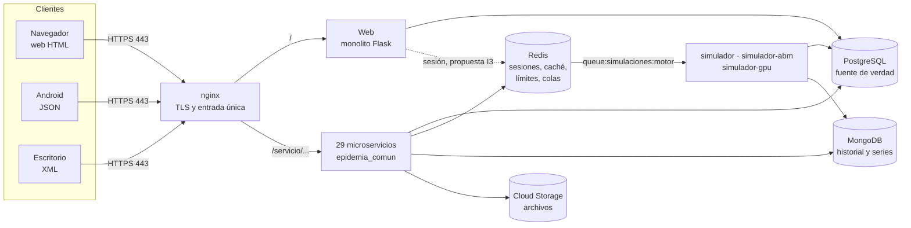
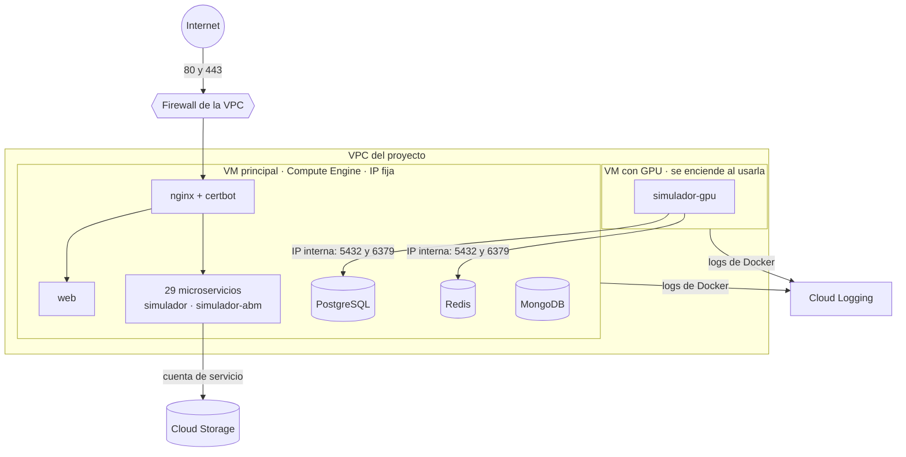

# Arquitectura v3

> **Estado: Borrador** · 2026-11-14 · Por validar en equipo (paso 6 de §11 de [`brechas_v3.md`](brechas_v3.md)). Al validarse reemplaza a [`arquitectura_v2.md`](arquitectura_v2.md); mientras tanto, lo que este documento no cambia sigue como en la v2.

La v3 es la arquitectura del tercer parcial: las apps cliente, la entrada por nginx, MongoDB, Cloud Storage, los límites de consumo, el ABM y el despliegue en GCP. Sale de los tres procesos ([`procesos_v3.md`](procesos_v3.md)), de las decisiones D1 a D31 ([`decisiones.md`](../decisiones/decisiones.md)) y del código de `feat/tercer-parcial` al 2026-11-14. Enlaza en vez de copiar: el detalle de cada servicio está en [`microservicios.md`](microservicios.md), y el del simulador en [`ficha_simulador.md`](ficha_simulador.md).

Si este documento y el catálogo no coinciden, manda el catálogo; si el catálogo y el código no coinciden, manda el código.

Cada pieza lleva su estado:

- **Hecho:** está en el código y tiene pruebas.
- **Falta:** está decidido y no implementado. Lleva su brecha y quién la tiene (integrante 2 MongoDB, 3 archivos y nginx, 4 seguridad y fallos, 5 simulador, 6 apps cliente, 7 nube y monitoreo).
- **Propuesta:** una forma de hacerlo que el equipo todavía no decide.

## 1. Qué cambia respecto a la v2

| Tema | v2 | v3 | Decisión | Estado |
|---|---|---|---|---|
| Entrada | Sin pasarela: cada servicio publica su puerto y el directorio da `host:puerto` | nginx en 80 y 443 con TLS; los servicios dejan de publicar puertos y el directorio da `https://<dominio>/<servicio>` | D25, D26 (ajustan D13) | Falta (N7, S6; integrante 3) |
| Web | Crea escenarios y lanza corridas | Consulta y aprueba; el diseño y las corridas son del escritorio | D4 | **Hecho** |
| Microservicios | 26, más cinco opcionales | 29: entran `dispositivos`, `evidencias` y `vacunas` para la móvil | D27 | **Hecho** |
| Apps cliente | La consola las sustituye | Android (JSON) y escritorio (XML) | D10 | **Hecho** en lo principal; ver §4 |
| Motor | SEIR por edad; FLAME GPU después | Tres motores con el mismo contrato: `seir-ref`, `abm-ref` y `abm-gpu`, cada uno con su simulador y su cola | D2, D22, D23 | **Hecho** |
| Población de un escenario | Habitantes | Agentes; el factor de escala se calcula fuera del motor | D6 | **Hecho** |
| Réplicas | — | 30 por omisión, semillas 1..N; el escritorio resume | D8 | **Hecho**, menos el aviso de bandas encimadas (integrante 6) |
| MongoDB | Fuera de la etapa | `historial_servicios` y `series_corridas` | D28 | Falta (D-1, D-2; integrante 2) |
| Archivos | Volumen de Docker de `evidencias` | Cloud Storage con URLs firmadas | D30 | Falta (D-3, D-4; integrante 3) |
| Límites de consumo | Fuera de la etapa | Un contador por usuario y ruta en Redis, en `epidemia_comun` | D31 | Falta (S2; integrante 4) |
| Salud y panel | `/health` con PostgreSQL y Redis; historial en Redis | Más MongoDB, bucket y tiempo de respuesta; historial en MongoDB y número de errores | D28 | Falta, en parte (N3, N4; integrante 7) |
| Despliegue | Pendiente | Compute Engine: una VM principal y una con GPU que se enciende solo cuando hace falta | D23, D25, D26 | Falta (N1, N2, N6; integrante 7) |
| Volumen de datos | — | Unas 10 000 corridas de 180 días, alrededor de 1.8 millones de documentos | D29 | Falta (D-6) |
| Pruebas de carga | Pendiente | Locust por perfil de uso | — | Falta (A4, A5) |
| Redis en el login de la web | No | La web también registra y revisa su sesión en Redis | Por decidir | Falta (I3); ver §5 |

## 2. Vista general

Siguen los seis principios de la v2 (§1): las apps no tocan las bases y la web sí, una tarea por servicio, un dueño por tabla, lo lento va a una cola, el motor está aislado y PostgreSQL es la fuente de verdad. El quinto ahora tiene tres implementaciones detrás del mismo contrato (`procesamiento/motores.py`). La v3 agrega dos:

**7. Una sola puerta.** Desde fuera solo se llega por nginx, en 443 (el 80 redirige). Ni los servicios ni las bases publican puertos en la nube. nginx no valida tokens ni tiene lógica: eso sigue en cada servicio (D25).

**8. Cada dato en su almacén.** PostgreSQL para lo que pide integridad, Redis para lo temporal que se puede reconstruir, MongoDB para lo de alta frecuencia que se agrega más de lo que se edita, y Cloud Storage para los archivos. La base solo guarda los metadatos de un archivo, nunca el archivo (§6).

## 3. Procesos

Los tres procesos integrales que pide la rúbrica, paso a paso, están en [`procesos_v3.md`](procesos_v3.md). Esta tabla dice qué le falta a cada uno para cumplir la lista de la rúbrica (I1):

| Proceso | Usuario y app | Servicios | Redis | PostgreSQL o MongoDB | Archivo en bucket | Auditoría | Notificación | Visualización |
|---|---|---|---|---|---|---|---|---|
| P1 · Captura en campo | CAPTURISTA, Android | `auth`, `sesiones`, `dispositivos`, `enfermedades`, `regiones`, `sincronizacion`, `casos`, `evidencias`, `vacunas` | Sí: sesión, candado y resultado del lote | Sí: `cases` | Falta: las fotos a GCS (D-3) | Sí | Falta (I1). Propuesta: un aviso por lote con casos nuevos a los EPIDEMIOLOGO | Sí: tablero y mapa de la web |
| P2 · Diseño y aprobación | ANALISTA en el escritorio; EPIDEMIOLOGO en la web | `escenarios`, `intervenciones`, `validacion`, `escenarios-xml`, `aprobacion`, `notificaciones` | Sí: sesión | Sí | Opcional. Propuesta: guardar el XML de intercambio | Sí | En parte: falta avisar a los EPIDEMIOLOGO al enviar a revisión, y al autor cuando se dictamina en la web (I1) | Sí: estado de la versión |
| P3 · Simulación y comparación | ANALISTA en el escritorio; consulta en la web | `corridas`, `simulador`, `resultados`, `comparacion`, `pareto`, `notificaciones` | Sí: sesión, candado, cola y avance | Sí: `simulation_results`; con D28, la serie en MongoDB | Falta: el reporte a GCS con URL firmada (D-3, D-4) | Sí | Sí: al terminar o fallar una corrida | Sí: escritorio y web |

Los tres usan PostgreSQL, que basta para la rúbrica («PostgreSQL o MongoDB»). MongoDB entra por el monitoreo y por las series del simulador (§6).

## 4. Clientes

| Cliente | Para quién | Qué hace | Formato | Estado |
|---|---|---|---|---|
| **Web** (`frontend_web/`, `backend_web/`) | Todos los roles; sitio público sin sesión | Tablero, mapa, catálogos, casos, administración y bitácora. Consulta escenarios y corridas, y el EPIDEMIOLOGO aprueba o rechaza versiones (D4). Va directo a PostgreSQL (D20) y funciona aunque los servicios estén caídos (I2) | HTML | **Hecho**. Falta la carga de archivos (D-5). Propuesta: subir evidencias con la misma interfaz de almacenamiento que `evidencias` (D30) |
| **Android** (`frontend_movil/`) | CAPTURISTA en campo | P1: casos sin conexión con GPS y fotos, sincronización por lotes, lotes de vacuna por QR o código de barras, avisos y perfil | JSON | **Hecho**: usa once servicios y seis capacidades del teléfono (cámara, GPS, código QR y de barras, notificaciones, almacenamiento local y sincronización). Falta un indicador de conexión fijo (C3) y el menú por rol (C8); C9 (actualizar información) está por decidir |
| **Escritorio** (`frontend_desktop/`) | ANALISTA y ADMINISTRADOR | P2 y P3: escenarios y su XML validado con XSD, envío a revisión, lotes de réplicas, comparación con Pareto, exportación e impresión | XML | **Hecho**. Falta mostrar la escala de D6, ofrecer `abm-gpu` en el selector de motor y el aviso de bandas encimadas (integrante 6). C10 (si «validación del JWT» pide revisar `exp` en la app) está por decidir |
| **Consola** (`microservicios/consola`) | El equipo | Swagger, probador y panel de salud de los 29 servicios | JSON y XML | **Hecho**. Es herramienta de pruebas, no cliente del producto |

Android y escritorio atienden procesos distintos (P1 contra P2 y P3), y el escritorio no copia a la web: D4 le deja el diseño y las corridas.

## 5. Microservicios

El catálogo de los 29 servicios, con sus puertos, tablas y llamadas, está en [`microservicios.md`](microservicios.md). Las convenciones de la v2 (§4.2) no cambian: rutas `/api/v1/` en inglés, XML por defecto y JSON a pedido, RFC 7807 con `codigo` estable, XSD validado con `xmlschema`, `X-Correlation-ID`, OpenAPI en `/docs` y un rol de PostgreSQL por servicio. Lo que cambia:

- **Detrás de nginx (D25, falta).**
  - `https://<dominio>/<servicio>/api/v1/...` llega a `<servicio>:8000/api/v1/...`, así que las rutas no cambian.
  - `estado-servicios` pasa a dar `https://<dominio>/<servicio>` en `URL_PUBLICA`.
  - Cada servicio tiene que funcionar detrás del prefijo: `/docs`, `/openapi.json` y el CORS de la consola.
  - En desarrollo los puertos de cada servicio siguen publicados, para la consola y las pruebas.
- **Límites de consumo (D31, falta).**
  - Un contador `ratelimit:<usuario>:<ruta>` en Redis, con ventana fija, en `epidemia_comun`, así que lo heredan los 29 servicios.
  - Es más permisivo en `casos` y `sincronizacion` y más estricto en `corridas`. Sin sesión, el contador va por IP.
  - Propuesta: responder 429 con `Retry-After` y un `codigo` nuevo, `LIMITE_EXCEDIDO`. Si Redis no responde, la ruta protegida ya responde 503 por la sesión, así que el límite no abre otro camino.
- **Simuladores por motor (hecho).**
  - `simulador` corre `seir-ref`, `simulador-abm` corre `abm-ref` y `simulador-gpu` corre `abm-gpu` (perfil `gpu`).
  - Cada uno toma solo su cola, `queue:simulaciones:<motor>`, y `corridas` acepta un motor solo si `MOTORES_HABILITADOS` lo nombra.
  - Un simulador cuyo motor no corre en esa máquina no arranca.
- **Reencolar al arrancar (D19, falta; integrante 4).** Hoy el trabajador cierra como fallidas las corridas que quedaron `ejecutando`; además debe volver a encolar las `encolado` de su motor.
- **Redis en la autenticación de la web (I3, por decidir).** La rúbrica pide que todos los componentes consulten Redis al autenticar, y la web hoy no lo hace. Hay dos opciones:
  - **Propuesta:** al iniciar sesión, la web registra la sesión con las mismas llaves `session:` de `epidemia_comun.sesiones`, y en cada petición revisa que siga abierta y que el token no esté revocado.
  - **Si Redis no responde:** falta decidir si la web falla cerrada, como los servicios, o si sigue con la firma y la expiración del token, para no perder su independencia (I2). Se registra como decisión nueva.

## 6. Datos

| Almacén | Qué guarda | Estado |
|---|---|---|
| PostgreSQL | La fuente de verdad: usuarios y roles, catálogos, casos, escenarios y versiones, corridas y sus resúmenes, avisos, auditoría y los metadatos de cada archivo. Esquema: migraciones `datos/postgres/migraciones/` hasta la 035; la 034 está reservada para D1 y la siguiente libre es la 036 | **Hecho** |
| Redis | Lo temporal y reconstruible (v2 §5.2): sesiones, revocaciones, captcha, caché, candados, resultado de lotes, avance de corridas y una cola por motor. Nuevo: `ratelimit:<usuario>:<ruta>` (D31) | **Hecho**, menos los límites |
| MongoDB | El historial de salud de los servicios y las series diarias de las corridas (D28) | Falta (integrante 2) |
| Cloud Storage | Fotos y evidencias, reportes exportados y, opcional, el XML de intercambio (D30) | Falta (integrante 3) |

**Diseño de MongoDB (D-2, D28).**

| Colección | Un documento es | Campos | Índices | Vida |
|---|---|---|---|---|
| `historial_servicios` | Un sondeo de `estado-servicios` a un servicio | `servicio`, `fecha`, `estado`, `latencia_ms`, `version`, `dependencias_caidas`, `error`, `version_esquema` | `{servicio, fecha}`; TTL sobre `fecha` | 30 días |
| `series_corridas` | Un día de una corrida | `run_id`, `batch_id`, `motor`, `engine_version`, `semilla`, `dia`, los compartimentos totales y por grupo de edad, `version_esquema` | `{run_id, dia}` único; `{batch_id}` | Lo que viva la corrida |

- **Versionamiento:** cada documento lleva `version_esquema`. Un cambio de forma sube el número, y quien lee acepta las versiones que conoce.
- **Crecimiento:** con D29 son unas 10 000 corridas de 180 días, alrededor de 1.8 millones de documentos en `series_corridas`. El tamaño en disco se mide al cargarlos (§9). El historial no crece sin fin, por el TTL.
- **Qué se demuestra:** inserción, consulta, actualización, agregación (disponibilidad y latencia por servicio; curvas por lote), índices y recuperación por `run_id`.
- **Lotes crudos de `sincronizacion`:** son una tercera colección solo si sobra tiempo (§10).

**Archivos en Cloud Storage (D-3, D-4, D30).**

- **Un bucket privado.** Propuesta: los prefijos `evidencias/`, `reportes/` y `xml/`, con acceso uniforme y sin lectura pública.
- **Qué guarda la base:** de cada archivo, solo identificador, ruta, tipo, tamaño, propietario, fecha, huella SHA-256, nivel de privacidad, estado y metadatos. Las evidencias ya tienen esos campos en `case_attachments`. Los reportes de P3 necesitan su tabla, con una migración nueva (036 o siguiente).
- **URLs firmadas:** el servicio dueño del archivo revisa el permiso y responde con una URL firmada de lectura que vence en minutos. Propuesta: V4 de 15 minutos. Ninguna URL es permanente.
- **Validación de archivos:** al subir se revisan el tipo por su contenido (no por la extensión), el tamaño máximo y la huella. Las fotos llegan ya reducidas y sin EXIF desde la móvil.
- **En local:** una interfaz de almacenamiento que cambia de disco a bucket por variable de entorno, o un emulador de GCS (D30).

## 7. Simulador

Todo el algoritmo está en [`ficha_simulador.md`](ficha_simulador.md), que cierra A1 y A2: problema, entradas, salidas, variables, restricciones, complejidad, pseudocódigo, casos de prueba, métricas, limitaciones y tiempo de ejecución.

- **Tres motores, un contrato (D2, D22, D23):**
  - `seir-ref` es el control experimental;
  - `abm-ref` es el modelo basado en agentes en CPU;
  - `abm-gpu` es el mismo modelo en FLAME GPU 2.

  Todos están en el registro `procesamiento/motores.py` y pasan las mismas pruebas de conformidad. **Hecho.**
- **Ciclo de una corrida:**
  1. El escritorio pide un lote a `corridas`, que revisa que la versión esté aprobada (D5).
  2. `corridas` la registra `encolado` y la mete a la cola de su motor.
  3. El simulador de ese motor la corre, guarda el resultado y avisa.
  4. `resultados`, `comparacion` y `pareto` leen lo guardado.

  El diagrama está en §2 de la ficha.
- **Población (D6):** el motor simula agentes. El factor de escala (habitantes del Censo 2020 / agentes) lo calcula `procesamiento/analitica/escala.py`, y `resultados` lo entrega junto a los conteos. **Hecho.**
- **Réplicas (D8):** 30 por omisión, con las mismas semillas en todas las versiones. El escritorio resume media, mediana y la banda del percentil 5 al 95, y la frontera de Pareto se calcula sobre las medianas. **Hecho**, menos el aviso de bandas encimadas.
- **Sin calibración (D24):** los resultados son escenarios, no pronósticos (`AVISO_SIMULACION`).
- **Dónde corre:**
  - `simulador` y `simulador-abm` van en la VM principal.
  - `simulador-gpu` va en la VM con GPU (§8). Nuevo León completo tarda 7.7 s por corrida en una RTX 4050, contra 80 a 90 s de `abm-ref`.
  - Sin GPU, `abm-ref` es el respaldo y ningún otro componente se entera.

## 8. Despliegue y seguridad

**Distribución en GCP (N1, N2; integrante 7).** Propuesta:

- **Máquinas:**
  - La VM principal corre el mismo `infra/docker-compose.yml` que en local, con nginx enfrente.
  - La VM con GPU corre solo `simulador-gpu` (perfil `gpu`), con NVIDIA Container Toolkit, y se apaga cuando no hay corridas de `abm-gpu`. El costo de las horas encendidas está por estimar contra los créditos (D23).
  - Los tipos de máquina se fijan con las mediciones de Locust (§9).
- **Bases en la VM, no administradas.** PostgreSQL, Redis y MongoDB corren en contenedores en la VM principal: el mismo compose que en desarrollo, sin costo extra sobre los créditos. La rúbrica lo permite si se justifica. Cloud SQL o MongoDB Atlas quedan como alternativa si la VM no da.
- **Firewall:**

  | Regla | Origen | Puertos | Destino |
  |---|---|---|---|
  | Web pública | Cualquiera | 80, 443 | VM principal |
  | Administración | Las IP del equipo, o IAP | 22 | Las dos VM |
  | Simulador GPU | VM con GPU (etiqueta de red) | 5432, 6379 | VM principal |
  | Todo lo demás | — | — | Denegado |

- **HTTPS (D26):** Let's Encrypt para un dominio que apunta a la IP fija, y certbot renueva. En local, nginx usa un certificado de mkcert.
- **Secretos (S5):** los `.env` se arman en cada VM, con permisos 600 y fuera del repositorio, como hoy. Propuesta: guardarlos en Secret Manager y que la VM los lea al arrancar con su cuenta de servicio. La cuenta de servicio del bucket solo tiene permisos sobre ese bucket.
- **Logs (N6):** propuesta: el driver `gcplogs` de Docker manda los registros de cada contenedor a Cloud Logging, con el `X-Correlation-ID` que ya llevan.

**Seguridad contra la rúbrica.**

| Requisito | Cómo | Estado |
|---|---|---|
| JWT de acceso, refresh, revocación y expiración | `auth` y `sesiones`; refresh de un solo uso, revocación en Redis (v2 §4.4) | **Hecho** (S1) |
| Roles y permisos por recurso | `@requiere_token(roles=...)`, un rol de PostgreSQL por servicio, matriz de D1 | **Hecho** |
| Rate limiting | D31 (§5) | Falta (S2) |
| Protección de endpoints | Token en toda ruta no pública; `@solo_servicios` para las internas; en la nube, solo nginx expuesto | **Hecho** en los servicios; nginx falta |
| Validación de archivos, XML y JSON | XSD con `xmlschema`, XML con `defusedxml`, validación de cada cuerpo; archivos según §6 | **Hecho** para XML y JSON; archivos, con GCS |
| Intentos fallidos y auditoría | `LOGIN_FAILED` y `audit_log` en la misma transacción que cada escritura | **Hecho** (S3) |
| Secretos protegidos | `.env` fuera de git; en GCP, según lo de arriba | Falta en GCP (S5) |
| Manejo seguro de errores | RFC 7807 sin traza ni SQL | **Hecho** |

## 9. Monitoreo, fallos y rendimiento

**Salud de cada servicio (N3).** `/health` agrega a lo de hoy (proceso, PostgreSQL, Redis y versión) el estado de MongoDB, el del bucket y el tiempo de respuesta. Propuesta: un servicio que no usa MongoDB o el bucket lo reporta como «no usa», en vez de omitirlo. Falta (integrante 7).

**Panel central (N4).** `estado-servicios` ya muestra el estado, la última revisión, la latencia, la versión y las dependencias caídas. Le faltan el número de errores y MongoDB y el bucket como dependencias. Su historial pasa de Redis a `historial_servicios` (§6), así que sobrevive a un reinicio de Redis y se puede agregar.

**Demostración de fallos (N5; integrante 4).**

| Qué falla | Qué debe pasar | Estado |
|---|---|---|
| Un microservicio se detiene | El panel lo marca caído; quien lo llama responde 503 `SERVICIO_NO_DISPONIBLE`; los demás siguen | Lo hace hoy; falta la demostración |
| Redis no responde | Las rutas protegidas responden 503 (fallan cerradas); las públicas y la caché de analítica siguen contra PostgreSQL; `corridas` no deja una corrida colgada; la web sigue (I2) | **Hecho** (`test_redis_caido.py`) |
| MongoDB no responde | El panel lo marca como dependencia caída y se pierde el historial de ese lapso. Propuesta: la corrida termina con su resumen en PostgreSQL y la serie se reintenta (integrante 2) | Falta |
| PostgreSQL no responde | `/health` en 503, el panel los marca degradados, y las escrituras fallan sin dejar datos a medias (una transacción por escritura) | Falta la demostración |
| El bucket no está disponible | La subida responde 503 y la app conserva el archivo para reintentar; el caso ya creado no se pierde | Falta |
| Una petición excede el tiempo | `llamar()` corta a los 5 s y responde 503; propuesta: un tiempo máximo también en nginx | En parte |

**Volumen de datos (D-6, D29).** Unas 10 000 corridas de 180 días con el SEIR, alrededor de 1.8 millones de documentos en `series_corridas`; con el ABM, sus corridas entran a la misma colección. Del lado de PostgreSQL, `gen_demo_data.py` genera cientos de miles de casos. Se mide:

- tiempo de inserción;
- consultas con y sin índice;
- consultas con y sin la caché de Redis;
- uso de CPU, memoria y disco;
- cómo escala con el número de corridas.

La cifra se confirma con el profesor.

**Pruebas de carga (A4, A5).** Locust con un perfil por uso real:

- personas consultando el tablero y la web;
- la móvil sincronizando lotes y subiendo fotos;
- el escritorio pidiendo comparaciones y reportes;
- administradores en el panel;
- procesos automáticos: el sondeo de `estado-servicios` y los simuladores tomando corridas.

Se reportan usuarios concurrentes, peticiones por segundo, tiempo medio, p95, p99, errores, saturación, recuperación y los endpoints más lentos. Falta.

## 10. Fuera de alcance

| Qué | Por qué | Decisión |
|---|---|---|
| Calibrar el modelo | No hay serie histórica ni fuente para ajustar los parámetros; los resultados son escenarios | D24 |
| Resumir las réplicas en el servidor | El escritorio resume este parcial; pasarlo a `corridas`, `comparacion` y `pareto` queda para la entrega final | D8 |
| Lotes crudos de `sincronizacion` en MongoDB | Tercera colección solo si sobra tiempo | D28 |
| GKE, Pub/Sub, BigQuery | Un compose en una VM y la cola de Redis bastan para el volumen de D29; la cola por motor ya reparte las corridas entre simuladores | — |
| Integración continua | No la pide la rúbrica; queda pendiente desde la v2 | — |

FLAME GPU ya no está aquí: `abm-gpu` está implementado y probado en contenedor (§7). Solo falta la VM con GPU en GCP.

## 11. Cotejo con la rúbrica

Los entregables del tercer parcial y dónde los cubre la v3:

| Entregable | Sección | Estado |
|---|---|---|
| Plataforma desplegada en GCP | §8 | Falta |
| Sistema web completo | §4 | **Hecho**, menos la carga de archivos (D-5) |
| Microservicios desplegados | §5, §8 | En local **hecho**; en GCP falta |
| Aplicación móvil Android funcional e integrada | §4 | **Hecho**, menos C3 y C8 |
| Aplicación de escritorio funcional e integrada | §4 | **Hecho** |
| Buckets configurados y URLs firmadas | §6 | Falta |
| Health checks y panel de monitoreo | §9 | En parte |
| Algoritmo complejo | §7 | **Hecho** |
| Conjunto de datos de alto volumen | §6, §9 | Falta |
| Pruebas Locust y resultados de rendimiento | §9 | Falta |
| Pruebas de fallos | §9 | En parte |
| Evidencia de seguridad | §8 | En parte |
| Integración completa (tres procesos) | §3 | En parte: bucket y notificaciones |
| Documentación actualizada | Este documento y los que enlaza | Borrador |
| Demostración en la nube | §8 | Falta |

Lo que no cae en ninguna sección es una brecha nueva y va a [`brechas_v3.md`](brechas_v3.md).
