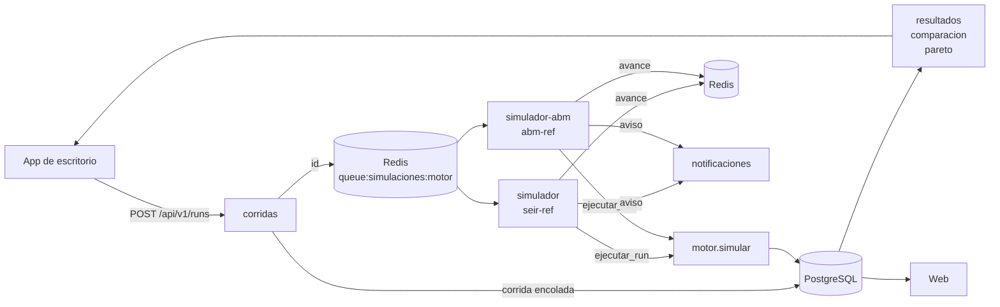

> **Estado: Vigente** · 2026-11-14 · Cierra la brecha A2 (§10.4 de [`brechas_v3.md`](brechas_v3.md)). Las mediciones se repiten con `python -m procesamiento.mediciones`.

# Ficha del simulador

El algoritmo complejo del proyecto es la simulación de un brote bajo un paquete de intervenciones. Lo hacen dos motores con el mismo contrato ([`docs/contratos/motor/README.md`](../contratos/motor/README.md)):

- **`seir-ref`** (`procesamiento/motor/`): SEIR estocástico por grupo de edad. Queda como control experimental (D2).
- **`abm-ref`** (`procesamiento/abm/`): modelo basado en agentes en Python (D22). Cada persona es un agente con su hogar, su salón o su centro de trabajo.

Sobre sus resultados trabajan dos cálculos de `procesamiento/analitica/`: la frontera de Pareto (costo contra impacto, D3) y el factor de escala (D6). `abm-gpu`, el mismo ABM en FLAME GPU 2 (D23), no está implementado: se hace solo si sobra tiempo.

## 1. Problema que resuelve

Para una enfermedad y una región de Nuevo León, estimar cómo evolucionaría un brote (casos, hospitalizaciones, fallecimientos, vacunados) con y sin intervenciones: cierre de escuelas o trabajos, reducción de aforo, cubrebocas, testeo con aislamiento y vacunación. Así se comparan paquetes de intervenciones por su impacto contra su costo, y la frontera de Pareto muestra cuáles no son peores que otro en los dos ejes.

Los resultados son **escenarios, no pronósticos**: no hay calibración contra datos observados (D24). Por eso `resultados`, `comparacion`, `pareto` y la web ponen ese aviso junto a cada resultado (`AVISO_SIMULACION`).

`abm-ref` existe para medir lo que el SEIR no ve. El SEIR mezcla a toda la población por igual; en el ABM el contagio se queda en hogares, salones y centros de trabajo, y se agota antes. La diferencia entre los dos, en los mismos escenarios y con las mismas semillas, es el aporte del ABM (D2).

## 2. Dónde corre



1. `corridas` revisa que la versión esté aprobada (D5), registra la corrida en PostgreSQL con su motor y su versión, y la mete a la cola de Redis de ese motor.
2. El `simulador` de ese motor (`SIMULADOR_MOTOR`) la toma y llama a `ejecutar_run` (`backend_web/simulaciones.py`):
   - arma la entrada desde la versión, con los parámetros que se congelaron al enviarla a revisión;
   - corre `simular()` del motor del lote (`procesamiento/motores.py`);
   - guarda la salida en `simulation_results`, audita y avisa.
3. `resultados`, `comparacion` y `pareto` leen lo guardado. El factor de escala (D6) se calcula ahí, fuera del motor.

Con D28, la serie diaria también irá a la colección `series_corridas` de MongoDB.

## 3. Entradas

`simular(escenario, semilla)`. El detalle de cada campo está en el contrato del motor.

| Entrada | Qué es |
|---|---|
| `poblacion` | Agentes simulados (D6): un total, o un conteo por grupo de edad (por ejemplo, del Censo 2020). |
| `infectados_iniciales` | Infectados el día 0, repartidos al azar entre los grupos según su tamaño. |
| `dias` | Horizonte, de 1 a 1 095. |
| `enfermedad` | `r0`, `incubacion_dias`, `infeccioso_dias`, `dias_hospitalizacion`, `tasa_hospitalizacion` y `letalidad`; las dos tasas, por grupo de edad. Cada uno con su fuente o marcado como supuesto. |
| `intervenciones` | Tipo, días de inicio y fin, cobertura, cumplimiento y los parámetros de su tipo. |
| `poblacion_edad_desconocida`, `politica_edad_desconocida` | Gente sin edad declarada en el censo, y si se excluye o se prorratea. |
| `capas_contacto` | Opcional: cómo se reparten los contactos entre hogar, escuela, trabajo y comunidad. |
| `semilla` | Entero mayor o igual a 0. Con ella, la corrida es reproducible. |

Fuera del motor, Pareto recibe además el costo unitario de cada tipo de intervención, y la escala, los habitantes de la región.

## 4. Salidas

| Salida | Qué es |
|---|---|
| `serie` | Una fila por día con `S`, `E`, `I`, `R`, `H`, `D`, `V`, los casos activos y lo nuevo de ese día (casos, hospitalizaciones, defunciones, dosis). |
| `resumen` | Casos acumulados, pico de casos activos y su día, hospitalizaciones, pico de hospitalizados, fallecimientos, tasa de ataque, vacunados protegidos y dosis, con su desglose por grupo de edad. |
| `trazabilidad_parametros` | De dónde salió cada parámetro (con fuente, sin fuente o supuesto). En `abm-ref` incluye los supuestos de la estructura de contactos. |
| `simplificaciones`, `avisos` | Lo que el modelo simplifica, y lo que se corrió distinto de lo pedido. |
| `engine_version`, `huella_escenario` | Qué motor y versión corrió, y la SHA-256 de la entrada. |

La analítica agrega la frontera de Pareto (costo contra una métrica de impacto) y la `escala` (cuántos habitantes representa cada agente y los conteos llevados a habitantes).

## 5. Variables

| Variable | Definición |
|---|---|
| Estado | `seir-ref`: cuántas personas hay en cada compartimento de cada grupo de edad. `abm-ref`: el compartimento de cada agente. |
| β | `r0 / infeccioso_dias`, la tasa de contagio por día de una persona infecciosa. |
| Probabilidades diarias | p_EI = 1 − e^(−1/incubación); p_sale_I = 1 − e^(−1/infeccioso); p_sale_H = 1 − e^(−1/hospitalización). |
| Reparto de quien sale de I | A H con `tasa_hospitalizacion`, a D directo con max(0, `letalidad` − `tasa_hospitalizacion`), a R el resto. En H muere con min(`letalidad`, `tasa_hospitalizacion`) / `tasa_hospitalizacion`. |
| Pesos de las capas | Hogar 0.35, escuela 0.15, trabajo 0.20 y comunidad 0.30 (supuesto, `CAPAS_CONTACTO_SUPUESTO`). |
| Efecto de una intervención | reducción × cobertura × cumplimiento, sobre su capa (o sobre todas); el testeo y aislamiento reduce la transmisión de todos los infecciosos. |
| Vacunación | Dosis diarias, tope por grupo (cobertura), prioridad (`edad_desc` o `aleatorio`) y eficacia. |
| Grupos de contacto (`abm-ref`) | Hogar, salón y centro de trabajo de cada agente, con tamaños medios de 3.5, 25 y 15 (supuestos). |
| escala_j (`abm-ref`) | Reparte el peso de las capas a las que el agente no pertenece entre las suyas, para que su contacto total sea el del SEIR. |
| Factor de escala (D6) | Habitantes de la región (Censo 2020) / agentes. |

**Fuerza de infección.** En `seir-ref` es la misma para todos:

    λ(t) = β · aislamiento(t) · Σ_capa peso_capa · contactos_capa(t) · I / vivos

En `abm-ref` es de cada susceptible j, con la fracción de infecciosos entre los demás vivos de su hogar, salón o trabajo, y entre todos los vivos en la comunidad:

    λ_j(t) = β · aislamiento(t) · escala_j · Σ_capa peso_capa · contactos_capa(t) · x_capa,j

Con un solo grupo por capa, λ_j es la λ del SEIR (sección 10). Cada susceptible se contagia con probabilidad 1 − e^(−λ).

## 6. Restricciones

- **Validación de la entrada** (`resolver`, igual en los dos motores): población de 1 000 a 20 000 000; horizonte de 1 a 1 095 días; ningún parámetro epidemiológico tiene valor por omisión; las tasas van entre 0 y 1; cada intervención trae sus parámetros obligatorios; priorizar por edad exige grupos de edad. Un escenario inválido regresa todos sus errores juntos.
- **Reproducibilidad:** la misma entrada con la misma semilla y la misma `engine_version` da exactamente la misma salida. Todo el azar sale de `np.random.default_rng(semilla)`, en un orden fijo.
- **Trazabilidad (regla 8):** cada parámetro y cada supuesto lleva su fuente o la marca de supuesto. No hay calibración (D24).
- **Solo versiones aprobadas** (D5): lo revisa `corridas` y, como última defensa, el trigger `fn_version_aprobada`.
- **Recursos de `abm-ref`:** la memoria crece con los agentes, unos 88 MB por millón (sección 12).

## 7. Complejidad

T es el número de días, G el de grupos de edad, N el de agentes, I el de intervenciones y k el de escenarios comparados.

| Cálculo | Tiempo | Memoria |
|---|---|---|
| `seir-ref` | O(T · (G + I)): cada día son sorteos binomiales por grupo, sin importar cuántas personas tenga. | O(G + T) |
| `abm-ref`: armar la población | O(N): permutaciones al azar y agrupación por tamaños. | O(N) |
| `abm-ref`: la corrida | O(T · N): cada día recorre a los agentes (estados, conteos por grupo con `bincount` en tres capas, un sorteo por susceptible). | O(N): unos 20 bytes por agente durante toda la corrida, y unos 88 en el pico por los arreglos de cada día |
| Costo de un escenario (Pareto) | O(I · T) | O(I) |
| Frontera de Pareto | O(k²): cada escenario se compara con los demás; `comparacion` acepta hasta 50. | O(k) |
| Comparación con r réplicas de v versiones (D8) | r · v corridas independientes; se reparten entre simuladores. | Lo de una corrida por simulador |

## 8. Pseudocódigo

**Un día de `seir-ref`** (`procesamiento/motor/modelo.py`):

```
para cada día t = 1..T:
    activas ← intervenciones vigentes en t
    λ ← β · aislamiento(activas) · contactos(activas) · I_total / vivos
    nuevos_E ← Binomial(S, 1 − e^(−λ))                        por grupo
    nuevos_I ← Binomial(E, p_EI)
    salen_I  ← Binomial(I, p_sale_I);  destino ← Multinomial(salen_I, [a H, a D, a R])
    salen_H  ← Binomial(H, p_sale_H);  mueren_H ← Binomial(salen_H, muerte en H)
    actualizar S, E, I, H, D, R
    para cada campaña de vacunación activa:
        repartir las dosis del día por prioridad, hasta el tope de cada grupo
        las que caen en susceptibles protegen con probabilidad = eficacia (S → V)
    revisar que S + E + I + R + H + D + V = población
    anotar la fila del día
resumen ← indicadores de la serie
```

**`abm-ref`** (`procesamiento/abm/`):

```
agentes ← un agente por persona, con su grupo de edad
hogares ← agentes al azar en grupos de tamaño 1 + Poisson(2.5)
salones ← agentes en edad escolar, en grupos de 1 + Poisson(24)
trabajos ← agentes en edad laboral, en grupos de 1 + Poisson(14)
escala_j ← peso total / peso de las capas del agente
infectar al azar a infectados_iniciales agentes
para cada día t = 1..T:
    para cada capa agrupada: contar infecciosos y vivos por grupo
    para cada susceptible j:
        λ_j ← β · aislamiento(t) · escala_j · Σ_capa peso · contactos_capa(t) · infecciosos_del_grupo / (vivos_del_grupo − 1)
        se contagia si un número al azar < 1 − e^(−λ_j)
    E → I, I → H/D/R y H → D/R con las mismas probabilidades que seir-ref, un sorteo por agente
    vacunación: el cupo de cada grupo como en seir-ref, a agentes al azar sin dosis previa
    anotar la fila del día con los conteos por estado
resumen ← los mismos indicadores que seir-ref
```

**Frontera de Pareto** (`procesamiento/analitica/pareto.py`):

```
para cada escenario p:
    p está dominado si algún otro q tiene costo(q) ≤ costo(p) e impacto(q) ≤ impacto(p),
    y es estrictamente menor en al menos uno de los dos
frontera ← los no dominados, ordenados por costo
```

## 9. Casos de prueba

Desde la raíz: `python -m pytest procesamiento/tests`. Son 102 pruebas.

| Archivo | Pruebas | Qué revisa |
|---|---|---|
| `test_motor.py` | 40 | `seir-ref`: misma semilla, misma corrida; la población se conserva todos los días; con R0 menor que 1 no hay brote; más R0, más ataque; cerrar escuelas reduce casos; vacunar a mayores de 60 reduce muertes; priorizar por edad salva más que al azar; las dosis no pasan la cobertura; la validación junta todos los errores y no inventa valores. |
| `test_caracterizacion_motor.py` | 4 | Salidas de referencia guardadas: cualquier cambio en los números se nota. |
| `test_resolver_robustez.py` | 1 | Un corpus de entradas raras: la validación nunca truena. |
| `test_contrato_motor.py` | 15 | Los dos motores cumplen el contrato, son reproducibles, no modifican su entrada y fallan igual ante un escenario o una semilla inválidos. |
| `test_abm.py` | 9 | Con un solo grupo por capa, `abm-ref` da lo mismo que el SEIR; con grupos reales el contagio se agota antes; cerrar escuelas protege más a los escolares; vacunar reduce los casos; la vacunación por edad empieza por los mayores y nadie pasa del tope ni recibe dos dosis; los grupos de contacto siguen la edad y su tamaño medio; sin grupos de edad, el reparto se sortea con el censo y se avisa. |
| `test_escala.py` | 5 | El factor de D6 y los conteos llevados a habitantes. |
| `test_pareto.py` | 28 | Dominancia, frontera, costo de cada intervención, comparación y que la analítica solo use nombres públicos del motor. |

Además, `backend_web` prueba una corrida completa de cada motor contra la base de pruebas, y `microservicios/pruebas_integracion/contenedores/test_compose_abm.py`, una de `abm-ref` de punta a punta en contenedores.

## 10. Métricas

**De resultado**, las que se comparan entre escenarios: casos acumulados, pico de casos activos y su día, hospitalizaciones, pico de hospitalizados, fallecimientos, tasa de ataque y dosis aplicadas. Con D6 también se muestran llevadas a habitantes.

**De una comparación (D8):** 30 réplicas por omisión, con las mismas semillas (1 a N) en todos los escenarios. Por escenario se resumen la media, la mediana y la banda del percentil 5 al 95, y la frontera de Pareto se calcula sobre las medianas. Este parcial lo calcula el escritorio (`frontend_desktop/app/resumen.py`); el aviso de bandas encimadas está pendiente (integrante 6).

**De validación.** Que `abm-ref` con un solo grupo por capa dé la tasa de ataque de `seir-ref` prueba que su fórmula no cambia nada más que la agrupación. Con hogares, salones y trabajos el ataque baja, sobre todo cerca del umbral:

<!-- python -m procesamiento.mediciones validacion · Python 3.14.4, NumPy 2.3.5, Windows 11 -->
| R0 | `seir-ref` | `abm-ref` con un solo grupo por capa | `abm-ref` con hogares, salones y trabajos |
|---|---|---|---|
| 1.3 | 0.496 | 0.496 | 0.157 |
| 1.6 | 0.718 | 0.721 | 0.590 |
| 2.5 | 0.922 | 0.921 | 0.882 |

Tasa de ataque media de 5 semillas, con 100 000 agentes, 180 días y sin intervenciones.

**De rendimiento:** segundos por corrida y memoria pico (sección 12).

## 11. Limitaciones

- **Sin calibración (D24):** no hay serie histórica ni fuente para ajustar los parámetros. Los que no tienen fuente van marcados como supuesto, y los resultados se leen como escenarios.
- **Duraciones geométricas** en pasos de un día: de cada distribución solo se usa la media.
- **Mezcla homogénea:** en `seir-ref` entre toda la población; en `abm-ref`, dentro de cada grupo de contacto y en la comunidad.
- **Estructura supuesta en `abm-ref`:** los tamaños de hogar, salón y trabajo y los pesos de las capas son supuestos, y los hogares se arman al azar, sin la composición por edad real. Quién estudia o trabaja sale del grupo de edad.
- **Testeo y aislamiento** como un factor sobre todos los infecciosos; no se aísla a personas concretas.
- **Enfermedades transmitidas por vector** (dengue, zika, malaria) aproximadas como contagio directo, sin mosquitos ni estacionalidad.
- **El factor de escala (D6) es una extrapolación:** supone que los habitantes no simulados se comportan como los simulados.
- **`abm-ref` corre en un solo núcleo:** Nuevo León completo tarda más de un minuto por corrida, y 30 réplicas de varias versiones, decenas de minutos. Se simulan menos agentes que habitantes (D6), o se reparten las corridas entre varios `simulador-abm`.
- **`abm-gpu`** (FLAME GPU 2) no está implementado.

## 12. Tiempo de ejecución

Medido con `python -m procesamiento.mediciones tiempos`: el escenario del contrato a 180 días, con cierre de escuelas y vacunación. Mediana de 3 corridas. Equipo: Intel Core i5-12450HX (8 núcleos, 12 hilos), 15.7 GB de RAM, Windows 11, Python 3.14.4 y NumPy 2.3.5, en un solo hilo.

<!-- python -m procesamiento.mediciones tiempos · Python 3.14.4, NumPy 2.3.5, Windows 11 -->
| Motor | Agentes | Días | Segundos | Memoria pico (MB) |
|---|---|---|---|---|
| `seir-ref` | 10,000 | 180 | 0.02 | 0 |
| `seir-ref` | 100,000 | 180 | 0.02 | 0 |
| `seir-ref` | 500,000 | 180 | 0.02 | 0 |
| `seir-ref` | 1,000,000 | 180 | 0.02 | 0 |
| `seir-ref` | 2,000,000 | 180 | 0.02 | 0 |
| `abm-ref` | 10,000 | 180 | 0.08 | 1 |
| `abm-ref` | 100,000 | 180 | 0.85 | 9 |
| `abm-ref` | 500,000 | 180 | 6.55 | 44 |
| `abm-ref` | 1,000,000 | 180 | 13.56 | 88 |
| `abm-ref` | 2,000,000 | 180 | 31.06 | 177 |

- `seir-ref` tarda lo mismo con cualquier población: sus sorteos son por grupo, no por persona.
- `abm-ref` crece en proporción a los agentes: de 14 a 16 s y unos 88 MB por millón, o entre 11 y 13 millones de agentes-día por segundo.
- Por extrapolación, Nuevo León completo (5 784 442 habitantes, un agente por habitante) tardaría de 80 a 90 s y usaría unos 510 MB.
- 30 réplicas de una versión con un millón de agentes son unos 7 minutos en un solo `simulador-abm`.
