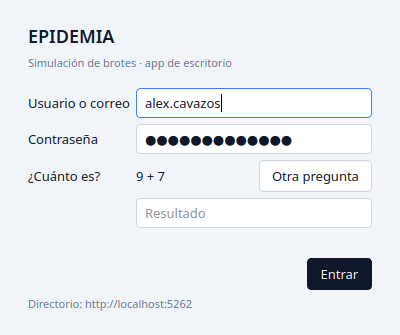
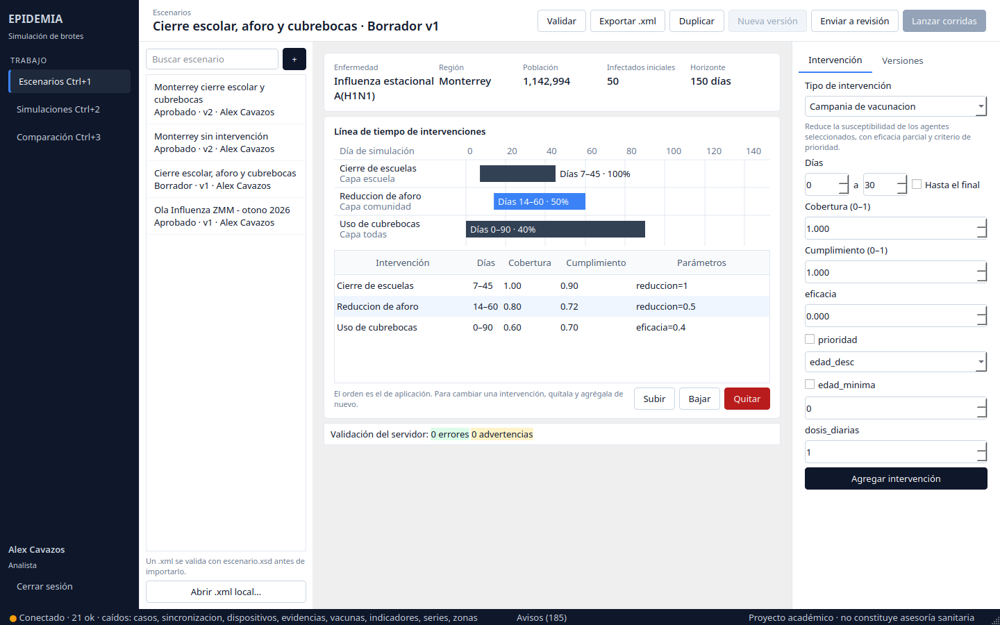
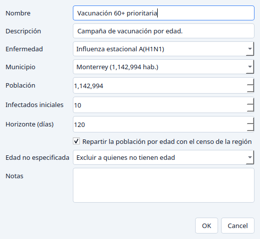
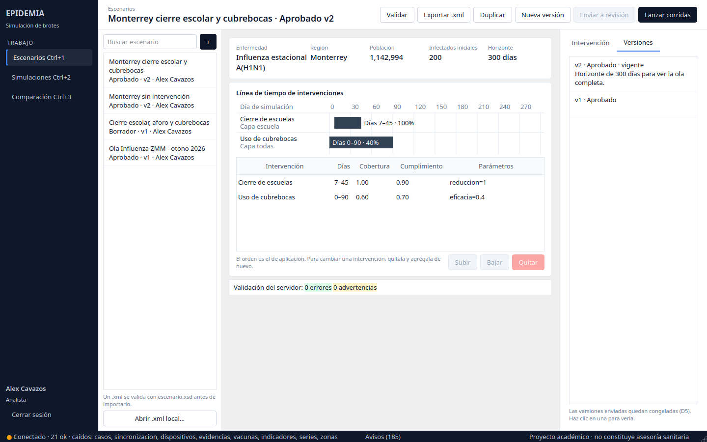
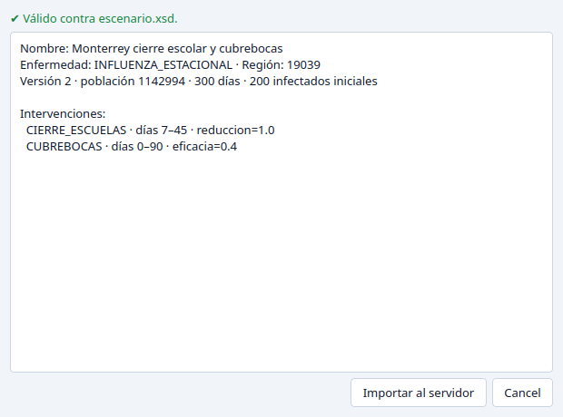
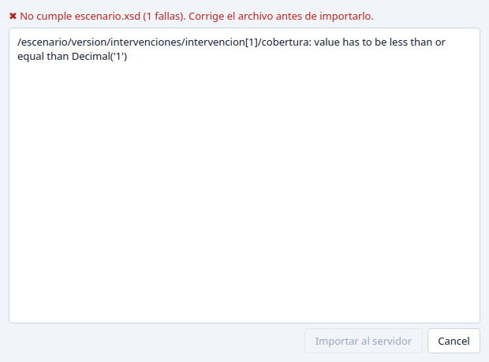
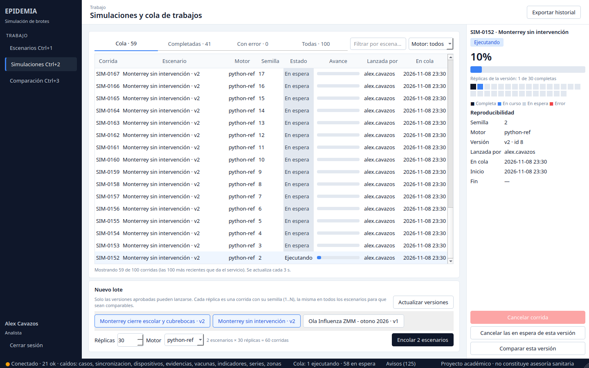
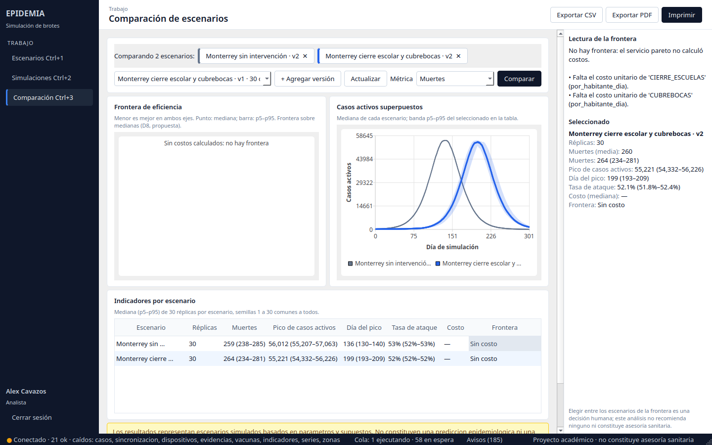
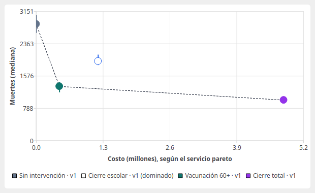
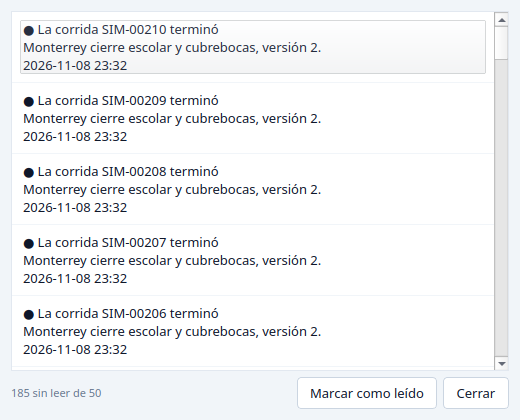

# Manual de usuario · App de escritorio EPIDEMIA

> **Estado: Vigente** · 2026-11-08 · Corresponde al MVP de `frontend_desktop/` del tercer parcial.

## 1. Para qué sirve

La app de escritorio sirve para **ensayar decisiones de salud pública antes de tomarlas**. Con
ella, el analista:

1. diseña un escenario, por ejemplo «cerrar escuelas del día 7 al 45 y usar cubrebocas»;
2. lo envía a revisión;
3. lo simula muchas veces, una vez por cada réplica;
4. compara los resultados contra otros escenarios.

> **Aviso.** Los resultados son escenarios simulados con parámetros y supuestos. **No son una
> predicción epidemiológica ni una recomendación sanitaria.** La app muestra este aviso en
> todas las pantallas de resultados. Elegir entre las opciones es una decisión humana.

### Quién la usa

| Rol            | ¿Entra al escritorio? | Qué hace                                                       |
|----------------|-----------------------|----------------------------------------------------------------|
| Analista       | Sí                    | Todo lo de este manual                                         |
| Administrador  | Sí                    | Lo mismo, y además edita escenarios ajenos y prueba fallos     |
| Epidemiólogo   | No                    | Aprueba o rechaza versiones en el **sistema web**              |
| Capturista     | No                    | Captura casos en la **app móvil**                              |

### El proceso completo

```
Escritorio (analista)                     Web (epidemiólogo)        Escritorio (analista)
──────────────────────                    ──────────────────        ─────────────────────
Crear escenario → intervenciones →        Aprobar o rechazar  →     Lanzar lote de réplicas →
validar → enviar a revisión                                         comparar → exportar / imprimir
```

## 2. Antes de empezar

### Instalar y abrir la app

Necesitas Python 3.9 o superior. Abre una terminal **en la raíz del repositorio**:

```bash
python3 -m venv .venv
source .venv/bin/activate          # en Windows: .venv\Scripts\activate
pip install -r frontend_desktop/requerimientos.txt
python -m frontend_desktop.run
```

En adelante basta con activar el entorno (`source .venv/bin/activate`) y correr la última
línea. Tiene que ser desde la raíz del repositorio. Si la corres desde otra carpeta, Python
responde `No module named 'frontend_desktop'`.

### Servidor

La app no guarda datos propios: todo lo pide a los microservicios, en XML. Solo necesita
conocer la dirección del **directorio de servicios**:

- **En tu máquina:** `http://localhost:5262`, que es el valor por omisión. Los servicios se
  levantan con Docker, como indica `frontend_desktop/README.md`.
- **En la nube:** antes de abrir la app, define
  `EPIDEMIA_DIRECTORIO=https://<dominio>/estado-servicios`.

La dirección en uso aparece al pie de la ventana de inicio de sesión.

## 3. Iniciar y cerrar sesión



1. Escribe tu **usuario o correo** y tu **contraseña**.
2. Resuelve la suma de la pregunta, por ejemplo «¿Cuánto es 5 + 7?». Si tardas más de 5
   minutos, pulsa **Otra pregunta**. Cada pregunta sirve para un solo intento.
3. Pulsa **Entrar** o presiona Enter.

La app revisa tu sesión con el servidor y tu rol. Si tu cuenta no es de analista ni de
administrador, te lo dice y no te deja entrar.

**Cerrar sesión:** botón **Cerrar sesión**, abajo a la izquierda. Al cerrar la ventana la
sesión también se cierra.

**Duración de la sesión**
- La sesión dura **8 horas** desde que entras.
- La app renueva tu acceso sola cada 20 minutos, sin pedirte nada.
- Si la sesión vence o un administrador la cierra, vuelve a aparecer la ventana de inicio de
  sesión. Lo que estabas viendo se recarga al volver a entrar.

**Errores al iniciar sesión**

| Mensaje                                                  | Qué hacer                                                         |
|----------------------------------------------------------|-------------------------------------------------------------------|
| Usuario o contraseña incorrectos.                        | Revisa ambos. Tras **5 fallos** la cuenta se bloquea 15 minutos, y el mensaje es el mismo mientras dure el bloqueo |
| El captcha es incorrecto o venció. Pide uno nuevo.       | La app ya cargó otra pregunta: respóndela y vuelve a intentar     |
| La app de escritorio es para analistas y administradores | Tu rol usa el sistema web o la app móvil                          |
| No se pudo conectar con el directorio de servicios       | Los servicios no están levantados o `EPIDEMIA_DIRECTORIO` está mal |

## 4. La ventana principal



- **Barra lateral (izquierda).** Tiene las tres pantallas: **Escenarios** (Ctrl+1),
  **Simulaciones** (Ctrl+2) y **Comparación** (Ctrl+3). Abajo están tu nombre, tu rol y
  **Cerrar sesión**.
- **Encabezado.** Muestra el título de lo que estás viendo y, a la derecha, las acciones
  disponibles. Una acción en gris no está permitida en ese momento; por ejemplo, no se puede
  lanzar corridas de un borrador.
- **Panel derecho.** Muestra el detalle o el formulario de la pantalla.
- **Barra de estado (abajo):**
  - **● Conectado · N ok.** Es la salud de los servicios, revisada cada 30 s. El punto se pone
    ámbar si alguno está degradado o caído, y rojo si no hay conexión.
  - **Cola.** Cuántas corridas se están ejecutando y cuántas esperan.
  - **Avisos (N).** Notificaciones sin leer (sección 8).

## 5. Escenarios

Un **escenario** describe una situación: enfermedad, municipio, población, infectados al inicio,
cuántos días simular y qué intervenciones se aplican. Cada cambio importante crea una
**versión** nueva (v1, v2…).

| Estado de la versión | Significa                                 | Qué puedes hacer                      |
|----------------------|-------------------------------------------|---------------------------------------|
| Borrador             | En edición                                | Editar, validar y enviar a revisión   |
| En revisión          | Un epidemiólogo la está revisando         | Esperar                               |
| Aprobado             | Lista para simular                        | Lanzar corridas y crear otra versión  |
| Rechazado            | No se aprobó; el comentario dice por qué  | Crear una versión nueva corregida     |

Una versión enviada a revisión **queda congelada**: ya no cambian ni sus datos ni sus
intervenciones. Para corregirla se crea otra versión.

### 5.1 Buscar y abrir

Escribe en **Buscar escenario** y presiona Enter. La lista muestra el nombre, el estado de la
versión vigente, el número de versión y el autor. Haz clic en un escenario para abrirlo.

### 5.2 Crear un escenario

Pulsa **+**, junto al buscador.



| Campo                | Notas                                                                              |
|----------------------|------------------------------------------------------------------------------------|
| Nombre               | Obligatorio, hasta 160 caracteres                                                  |
| Enfermedad           | Solo aparecen las que tienen parámetros completos para simular                     |
| Municipio            | Uno de los 51 de Nuevo León. Al elegirlo se llena su población del censo           |
| Población            | De 1,000 a 20,000,000                                                              |
| Infectados iniciales | Al menos 1, y no más que la población                                              |
| Horizonte (días)     | De 1 a 1,095                                                                       |
| Repartir por edad    | Usa los grupos de edad del censo. Lo necesitan algunas intervenciones (ver 5.3)    |
| Edad no especificada | Qué hacer con quienes no tienen edad en el censo: excluirlos o repartirlos         |

El escenario nace como **Borrador v1** y se abre solo.

### 5.3 Intervenciones

En el panel derecho, pestaña **Intervención**:

1. Elige el **tipo de intervención**. Debajo aparece qué hace.
2. Indica los **días**: inicio y fin, o marca **Hasta el final**.
3. Ajusta la **cobertura** (qué fracción de la población alcanza, de 0 a 1) y el
   **cumplimiento** (qué fracción la respeta, de 0 a 1).
4. Llena los parámetros del tipo. Los que tienen casilla son opcionales: márcala para usarlos.
5. Pulsa **Agregar intervención**.

| Tipo                    | Parámetros principales                                                       |
|-------------------------|------------------------------------------------------------------------------|
| Cierre de escuelas      | `reduccion` (0–1, 1 = cierre total)                                          |
| Cierre de trabajos      | `reduccion`, y `sectores` (opcional, separados por comas)                    |
| Reducción de aforo      | `reduccion` (0–1)                                                            |
| Uso de cubrebocas       | `eficacia` (0–1)                                                             |
| Vacunación              | `eficacia` (0–1), `dosis_diarias`, `prioridad` y `edad_minima` (opcionales)  |
| Testeo y aislamiento    | `deteccion` (0–1), `retraso_dias`, `dias_aislamiento` (opcional)             |

Las intervenciones aparecen en la **línea de tiempo** y en la tabla. Haz clic en una barra o en
un renglón para seleccionarla. Con una intervención seleccionada:
- **Subir / Bajar** cambian el orden en que se aplican.
- **Quitar** la elimina.
- Para cambiarla, quítala y agrégala de nuevo con los valores correctos.

**Reglas que revisa el servidor**
- Dos intervenciones del mismo tipo no pueden encimarse en el tiempo.
- Los días deben caber en el horizonte.
- La vacunación con `prioridad = edad_desc` necesita la población **repartida por edad**.

### 5.4 Validar

Pulsa **Validar**. El servidor revisa el escenario con las mismas reglas que usa el motor. El
resultado aparece abajo de la tabla:

- **errores:** impiden simular y hay que corregirlos;
- **advertencias:** no impiden simular, pero conviene leerlas. Por ejemplo, un parámetro sin
  fuente documentada.

### 5.5 Enviar a revisión

Con la versión en borrador, sin errores y siendo tú el autor o administrador, pulsa
**Enviar a revisión** y confirma.

- La versión pasa a **En revisión** y queda congelada.
- Un epidemiólogo la aprueba o rechaza en el sistema web.
- Si la aprueba, te llega un aviso (sección 8). Si la rechaza, la versión aparece como
  **Rechazado** y el comentario del revisor se muestra arriba de la validación.

### 5.6 Versiones

La pestaña **Versiones** del panel derecho muestra el historial con el estado y las notas de
cada versión. Haz clic en una para verla. Las anteriores son de solo lectura.



**Nueva versión** se habilita cuando la vigente ya no es borrador (aprobada o rechazada):

- Copia las intervenciones de la vigente.
- Puedes cambiar población, infectados, horizonte y reparto por edad.
- Las **notas son obligatorias**: explican qué cambia.

**Duplicar** crea un escenario nuevo, con otro nombre, a partir de la versión que estás viendo.

### 5.7 Exportar e importar XML

El escenario se puede guardar como archivo `.xml`, que sigue el esquema `escenario.xsd`. Sirve
para guardar una copia, compartirla o editarla con cuidado fuera de la app.

**Exportar:** pulsa **Exportar .xml** y elige dónde guardarlo. El archivo sale validado contra
el esquema.

**Importar:**
1. Pulsa **Abrir .xml local…** (abajo de la lista) y elige el archivo.
2. La app lo valida **antes de mandarlo**:
   - Si es válido, muestra un resumen: nombre, enfermedad, región, población e intervenciones.

     

   - Si no cumple el esquema, dice qué parte del archivo falla y no deja importarlo.

     

3. Pulsa **Importar al servidor**. Se crea un escenario nuevo en borrador, con sus
   intervenciones, y se abre.

En el archivo, la enfermedad y la región van por **código** (por ejemplo `INFLUENZA_ESTACIONAL`
y `19039`), no por nombre. La población máxima que acepta el esquema es de 5,000,000.

## 6. Simulaciones

Cada **corrida** simula una versión aprobada con una **semilla**: el número que fija el azar.
La misma semilla da siempre el mismo resultado.

Una sola corrida no basta para comparar escenarios, porque otra semilla da otro resultado
igual de válido. Por eso se lanzan **réplicas**: varias corridas de la misma versión con
semillas distintas.



### 6.1 Lanzar un lote

En **Nuevo lote** (parte inferior):

1. Marca las **versiones aprobadas** que quieres simular. Si acabas de aprobar una y no aparece,
   pulsa **Actualizar versiones**. Desde Escenarios, el botón **Lanzar corridas** te trae aquí
   con esa versión ya marcada.
2. Elige las **réplicas** por escenario. Son 30 por omisión, con un máximo de 100. Si eliges
   menos de 30, la app pide confirmación: con pocas réplicas la comparación es menos confiable.
3. Elige el **motor**. Hoy solo existe `seir-ref`.
4. Pulsa **Encolar N escenarios**.

Cada escenario usa las semillas **1, 2, …, N**. Todos los escenarios del lote usan las
**mismas semillas**, así las diferencias se deben a las intervenciones y no al azar.

Mientras se encolan, una barra muestra el avance. **Detener** deja de encolar las que faltan;
las que ya se encolaron siguen su curso.

### 6.2 Seguir la cola

La tabla se actualiza cada 3 segundos.

- **Pestañas:** **Cola** (en espera y ejecutando), **Completadas**, **Con error** y **Todas**.
- **Filtrar:** por nombre del escenario o por número (`SIM-0042` o `42`).
- **Motor:** limita la tabla a un motor.

La tabla muestra las 100 corridas más recientes.

| Estado      | Significa                                              |
|-------------|--------------------------------------------------------|
| En espera   | En la cola; todavía puede cancelarse                   |
| Ejecutando  | El motor la está simulando                             |
| Completada  | Terminó; sus resultados están listos para comparar     |
| Error       | Falló; el panel derecho muestra el motivo              |
| Cancelada   | Se canceló antes de ejecutarse                         |

### 6.3 Detalle de una corrida

Haz clic en una corrida. El panel derecho muestra:

- el avance;
- la **rejilla de réplicas** de su versión: un cuadro por semilla, negro si está completa, azul
  si está en curso, gris si está en espera y rojo si tuvo error;
- los datos de **reproducibilidad**: semilla, motor, versión, quién la lanzó y cuándo se encoló,
  empezó y terminó.

Botones del panel:
- **Cancelar corrida:** solo funciona con corridas en espera.
- **Cancelar las en espera de esta versión:** cancela el resto del lote de esa versión.
- **Comparar esta versión:** la lleva a la pantalla de Comparación.

**Exportar historial** guarda en CSV las corridas que estás viendo.

## 7. Comparación



*En este ejemplo, el cierre escolar con cubrebocas retrasa el pico de casos activos del día
136 al 199. Las muertes y la tasa de ataque al final del horizonte son parecidas, porque las
medidas terminan (días 45 y 90) antes de la ola.*

### 7.1 Elegir qué comparar

- Usa la lista de versiones con corridas completadas y pulsa **+ Agregar versión**, o llega
  desde Simulaciones con **Comparar esta versión**.
- Necesitas **al menos dos versiones**. Quita una con la **✕** de su ficha.
- Elige la **métrica** de impacto: muertes o pico de casos activos.
- Pulsa **Comparar**.

### 7.2 Cómo se calculan los números

- De cada versión se toma una corrida completada por semilla. Si una semilla se corrió dos
  veces, se usa la más reciente.
- Solo se usan las **semillas comunes** a todas las versiones elegidas. Si no hay ninguna en
  común, la app lo avisa: lanza un lote con las mismas réplicas para todas.
- Por escenario se muestra la **mediana** y, entre paréntesis, el rango del **percentil 5 al
  95** de las réplicas. El panel derecho agrega la **media**.

  Cómo leerlo: «264 (234–281)» quiere decir que la mitad de las réplicas dio menos de 264
  muertes, y que el 90 % central quedó entre 234 y 281.

### 7.3 Curvas de casos activos

Hay una línea por escenario, con la mediana de casos activos por día. El escenario que
selecciones en la tabla muestra además su **banda p5–p95**: el rango donde cayó el 90 % de sus
réplicas.

### 7.4 Frontera de eficiencia

Cada punto es un escenario: el **costo** en el eje horizontal y la **mediana del impacto** en el
vertical. La barra vertical es su rango p5–p95. Menor es mejor en ambos ejes.

Un escenario está **dominado** si otro cuesta igual o menos y tiene igual o menos impacto,
siendo mejor en al menos uno de los dos. Los escenarios que no están dominados forman la
**frontera**: la línea punteada.

- **Punto relleno:** escenario en la frontera.
- **Punto hueco:** escenario dominado.



*Ejemplo con **datos ilustrativos**, no salidos del sistema. «Cierre escolar» está dominado por
«Vacunación 60+», que cuesta menos y tiene menos muertes. Los otros tres forman la frontera:
entre ellos, bajar muertes cuesta más, y elegir es una decisión de política.*

El panel **Lectura de la frontera** dice, sin recomendar nada, qué escenarios están en la
frontera y cuáles están dominados y por quién.

**Si no hay frontera.** El costo lo calcula el servicio con los costos unitarios de cada tipo de
intervención. Cada uno debe tener su fuente o la marca de supuesto. Si falta alguno, el sistema
**no inventa la cifra**:
- la comparación sigue, con la tabla y las curvas;
- la gráfica de frontera dice «Sin costos calculados»;
- el panel lista qué costo falta.

Los costos los registra un epidemiólogo o un administrador.

### 7.5 Exportar e imprimir

- **Exportar CSV:** guarda dos archivos. `comparacion.csv` tiene la tabla, con media, mediana,
  p5 y p95 de cada indicador. `comparacion_curvas.csv` tiene las curvas día por día.
- **Exportar PDF:** reporte con las dos gráficas, la tabla, las semillas usadas, el aviso de que
  no es predicción y los supuestos de costo.
- **Imprimir:** el mismo reporte, a la impresora que elijas.

## 8. Avisos

El botón **Avisos (N)** de la barra de estado abre las notificaciones; N es cuántas no has
leído. Llegan cuando:
- una corrida termina o falla;
- un epidemiólogo aprueba una de tus versiones.

Los rechazos no generan aviso: se ven en el estado de la versión (sección 5.5).

Selecciona un aviso y pulsa **Marcar como leído**.



## 9. Registro de actividad

La app guarda en tu computadora un registro de lo que haces y de cada petición al servidor, con
su número de seguimiento (`cid`). Sirve para explicar un error a soporte. No guarda contraseñas
ni tokens.

| Sistema  | Ubicación                                                         |
|----------|-------------------------------------------------------------------|
| Linux    | `~/.local/share/epidemia-escritorio/actividad.log`                |
| Windows  | `C:\Users\<usuario>\AppData\Roaming\epidemia-escritorio\actividad.log` |
| macOS    | `~/Library/Application Support/epidemia-escritorio/actividad.log` |

La ruta exacta se imprime en la terminal al abrir la app. Además, el servidor guarda su propia
bitácora de auditoría de todo lo que cambias.

## 10. Problemas frecuentes

| Ves esto                                                     | Causa probable                                         | Qué hacer                                                  |
|--------------------------------------------------------------|--------------------------------------------------------|------------------------------------------------------------|
| «No se pudo conectar con *servicio*»                         | Ese servicio está caído                                | Revisa la barra de estado; avisa a quien administra el servidor |
| «El servicio no está disponible. Intenta más tarde.»         | El servicio o Redis no responden                       | Espera y reintenta                                         |
| «Respuesta inválida de *servicio*: no cumple *x*.xsd»        | El servidor respondió algo fuera de su contrato        | Repórtalo con el `cid` del registro de actividad           |
| «No tienes permiso para esta operación.»                     | Tu rol no puede hacer eso, o el escenario es de otra persona | Pide al autor o a un administrador que lo haga        |
| La ventana de inicio de sesión aparece sola                  | La sesión venció o fue cerrada                         | Vuelve a iniciar sesión                                    |
| Los botones de edición están en gris                         | La versión ya no es borrador o no es tuya              | Crea una **Nueva versión** o **Duplica** el escenario      |
| «Lanzar corridas» en gris                                    | La versión no está aprobada                            | Envíala a revisión y espera la aprobación                  |
| «… no tienen corridas completadas con la misma semilla»      | Las versiones se simularon con semillas distintas      | Lanza un lote con las mismas réplicas para todas           |
| «Sin costos calculados: no hay frontera»                     | Falta el costo unitario de alguna intervención         | Ver 7.4                                                    |
| «Falta el costo unitario de …» al comparar                   | Igual que el anterior                                  | Ver 7.4                                                    |
| «… requiere poblacion por grupo de edad»                     | Vacunación por edad sin reparto por edad               | Crea una versión con **Repartir por edad**, o usa otra prioridad |

## 11. Atajos de teclado

| Atajo     | Acción                                               |
|-----------|------------------------------------------------------|
| Ctrl+1    | Escenarios                                           |
| Ctrl+2    | Simulaciones                                         |
| Ctrl+3    | Comparación                                          |
| Enter     | Buscar (en el buscador) o Entrar (en el inicio de sesión) |

## 12. Glosario

- **Escenario.** Situación que se simula: enfermedad, municipio, población e intervenciones.
- **Versión.** Fotografía de un escenario. Una vez enviada a revisión ya no cambia.
- **Intervención.** Medida que se aplica durante unos días: cierres, cubrebocas, vacunación…
- **Cobertura / cumplimiento.** A qué fracción de la población llega la medida, y qué fracción
  la respeta.
- **Corrida.** Una simulación de una versión con una semilla.
- **Semilla.** Número que fija el azar de una corrida; la misma semilla repite el resultado.
- **Réplica.** Cada una de las corridas de la misma versión con semillas distintas.
- **Mediana.** El valor del centro: la mitad de las réplicas quedó por debajo y la mitad por
  encima.
- **p5–p95.** Rango donde cayó el 90 % central de las réplicas.
- **Tasa de ataque.** Fracción de la población que se infectó durante el horizonte.
- **Dominado.** Escenario para el que existe otro igual o mejor en costo e impacto, y mejor en
  al menos uno de los dos.
- **Frontera de eficiencia.** Los escenarios que no están dominados.
